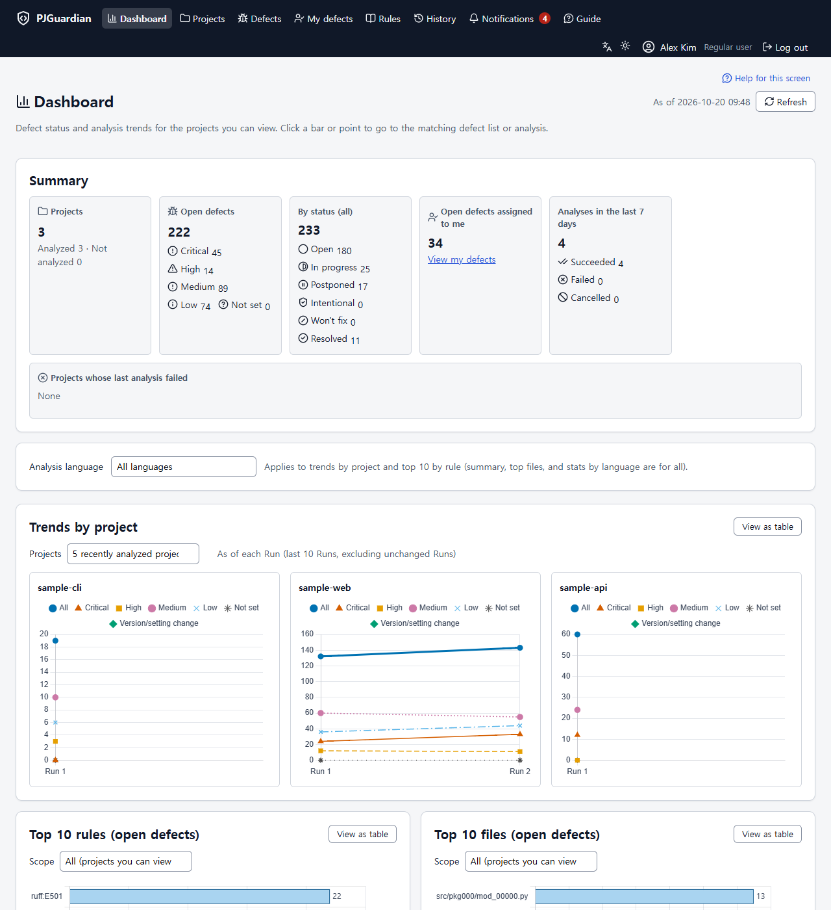
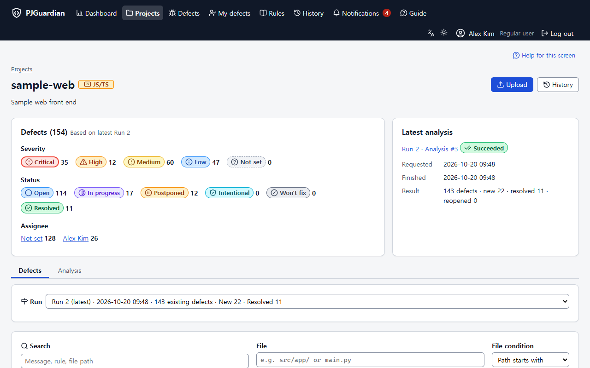
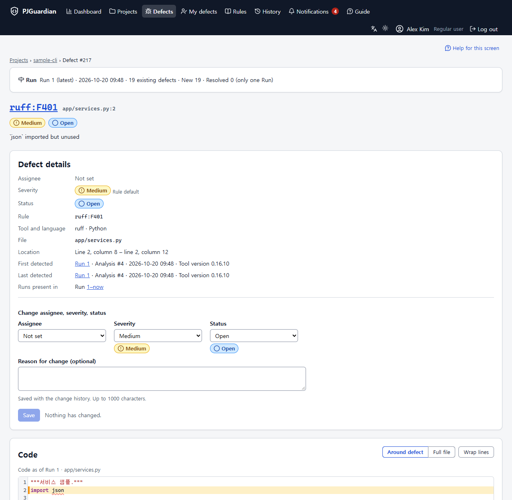
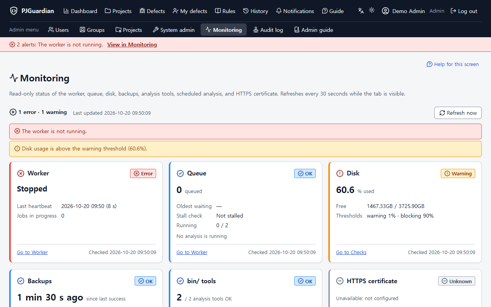
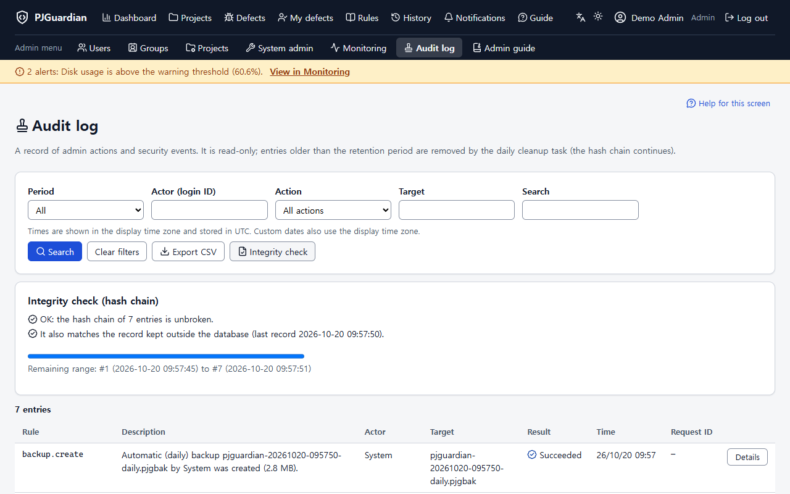

# PJGuardian

[한국어](README.ko.md)

PJGuardian is a self-hosted web application where a team manages static analysis results together: it runs **ruff** (Python) and **ESLint** (JavaScript/TypeScript) on uploaded code or a Git/Perforce repository, tracks every defect across analyses, and lets people assign, triage and follow them.

> [!WARNING]
> **The first administrator account is created with the password `admin`.** It is not forced to change on first sign-in. Change it **immediately after installation** (until you do, administrators see a warning banner and the hardening check reports it). The password is public knowledge because this repository is public.

## Features

- **Upload and analyze**: resumable chunked upload of zip files or a whole folder (up to 2 GB by default), safe extraction, a pre-check with warnings before the analysis starts, and a queue processed by a background worker.
- **Defect tracking**: defects are identified by a content-based signature, so they survive line shifts. Re-analysis resolves defects that disappeared and reopens ones that came back. Assignee, severity, status, bulk changes and "my defects".
- **Runs, history and dashboard**: every successful analysis is a Run; view any past Run read-only, compare with the previous Run, and follow trends on the dashboard.
- **Rules**: rule descriptions for the installed ruff and ESLint versions, plain-language guides with examples for common rules, and admin control to turn rules on or off.
- **Git and Perforce**: import from repositories on an allowed-host list, scheduled analysis, and "no change" detection.
- **Operations**: users, groups and per-project access, LDAP/Active Directory and SSO (OpenID Connect, SAML 2.0), backup and restore, system monitoring with a `/health` endpoint, admin alert e-mail, a tamper-evident audit log, and an upgrade maintenance mode.
- **Interface**: Korean and English, light and dark themes, a built-in user/admin guide and FAQ, CSV/Excel export.

See [docs/features.md](docs/features.md) for the full tour with screenshots.

## Screenshots

| Dashboard | Defects |
| --- | --- |
|  |  |
| **Defect detail and code viewer** | **System monitoring** |
|  |  |
| **Audit log** | **Dark theme** |
|  |  |

All screenshots use made-up demo data.

## Requirements

| Component | Version |
| --- | --- |
| OS | Windows (tested) or Linux (not yet verified — see [docs/unverified.md](docs/unverified.md)); macOS is not supported |
| Web server | Apache 2.4 with HTTPS (XAMPP works); only `public/` is exposed |
| PHP | 8.2 or later with `pdo_sqlite`, `zip`, `mbstring`, `openssl`, `fileinfo`, `intl` (and `ldap` for LDAP sign-in) |
| SQLite | 3.38 or later (bundled with PHP) |
| Composer | to install the PHP libraries into `vendor/` (SAML, e-mail) |
| Node.js | 20.19 or later, to run ESLint |
| Analysis tools | ruff and ESLint placed in `bin/` with checksum manifests — see [docs/bin_setup.md](docs/bin_setup.md) |

## Quick install

1. Put the code **outside the web root**, run `composer install --no-dev`, and point an Apache HTTPS virtual host at `public/` ([docs/xampp_vhost.md](docs/xampp_vhost.md)).
2. Copy `config/config.ini.example` to `config/config.ini` and `config/secrets.example` to `config/secrets.ini`, set `app.base_url`, then run `php tools/make_secret_key.php`.
3. Place ruff, ESLint and Node.js ([docs/bin_setup.md](docs/bin_setup.md)) and run `php tools/check_env.php`.
4. Create the database and the first administrator: `php tools/migrate.php`, then `php tools/create_admin.php --login=admin --name="Administrator"`.
5. Start the worker (`php tools/worker.php`, as a scheduled task or service — [docs/worker_setup.md](docs/worker_setup.md)), sign in, and **change the `admin` password**.

Details: [docs/install_quick.en.md](docs/install_quick.en.md) · Korean: [docs/install_quick.ko.md](docs/install_quick.ko.md). Before going to production, follow [docs/hardening.md](docs/hardening.md) and [docs/release_checklist.md](docs/release_checklist.md).

## Documentation

- [docs/README.md](docs/README.md) — index of operator and developer documents (mostly Korean)
- The in-app **Guide** menu — user and administrator guides in Korean and English
- [CHANGELOG.md](CHANGELOG.md) — release notes
- [docs/ci_status.md](docs/ci_status.md) — continuous integration status

## Status

Version 1.0.0. Developed and tested on Windows with XAMPP. Linux, real LDAP/AD and identity providers, and real SMTP servers have not been verified yet; the list of unverified items and how to check them is in [docs/unverified.md](docs/unverified.md).

## AI-assisted development

PJGuardian was developed with the help of an AI coding assistant (Claude Code). A person defined the requirements, reviewed each step, ran the tests and checks, and decided what to commit. See [docs/legal/AI_ASSISTED.md](docs/legal/AI_ASSISTED.md).

## Contributing and security

- [CONTRIBUTING.md](CONTRIBUTING.md) — development setup, tests and rules
- [SECURITY.md](SECURITY.md) — how to report a vulnerability (please do not open a public issue)
- [CODE_OF_CONDUCT.md](CODE_OF_CONDUCT.md)

## License and notices

Copyright (c) 2026 resious71. PJGuardian is licensed under the [Apache License 2.0](LICENSE). See [NOTICE](NOTICE) and [THIRD_PARTY_NOTICES](THIRD_PARTY_NOTICES) for bundled third-party software.

- **No warranty**: provided "AS IS"; it shows the output of static analysis tools and does not guarantee code quality or security — [docs/legal/DISCLAIMER.md](docs/legal/DISCLAIMER.md)
- **Trademarks**: ruff, ESLint, Git, Perforce, GitHub and other names belong to their owners; no affiliation — [docs/legal/TRADEMARKS.md](docs/legal/TRADEMARKS.md)
- **Privacy**: no telemetry; what an installation stores and where it can connect — [docs/legal/PRIVACY.md](docs/legal/PRIVACY.md)
- **AI-assisted development**: [docs/legal/AI_ASSISTED.md](docs/legal/AI_ASSISTED.md)
- **Security**: change the initial password, use HTTPS, keep `config/secrets.ini` and backups private — [SECURITY.md](SECURITY.md)
