# PJGuardian

[English](README.en.md)

**라이선스** Apache-2.0 · **버전** 1.0.0 · **PHP** 8.2 이상 · **분석 도구** ruff, ESLint · **개발·시험 환경** Windows + XAMPP(Linux는 아직 확인하지 않음)

PJGuardian은 팀이 정적 분석 결과를 함께 관리하는 설치형 웹 애플리케이션입니다. 업로드한 코드나 Git/Perforce 저장소를 **ruff**(Python)와 **ESLint**(JavaScript/TypeScript)로 분석하고, 분석이 거듭되어도 결함을 이어서 추적하며, 담당자 지정·분류·처리를 함께 할 수 있게 합니다.

> [!WARNING]
> **최초 관리자 계정의 비밀번호는 `admin`으로 만들어집니다.** 첫 로그인 때 변경을 강제하지 않습니다. **설치 직후 바로 바꾸세요**(바꾸기 전까지 관리자 화면에 경고 배너가 보이고 하드닝 점검이 경고합니다). 이 저장소가 공개되어 있으므로 이 비밀번호는 누구나 아는 값입니다.

**목차**: [주요 기능](#주요-기능) · [화면](#화면) · [요구 사항](#요구-사항) · [빠른 설치](#빠른-설치) · [문서](#문서) · [상태](#상태) · [기여와 보안](#기여와-보안) · [라이선스와 고지](#라이선스와-고지)

## 주요 기능

- **업로드와 분석**: zip 파일이나 폴더 전체를 조각으로 나눠 올리고 끊기면 이어 올립니다(기본 2GB까지). 안전하게 압축을 풀고, 분석 전에 대상 파일과 경고를 보여 준 뒤, 백그라운드 워커가 대기열 순서대로 분석합니다.

  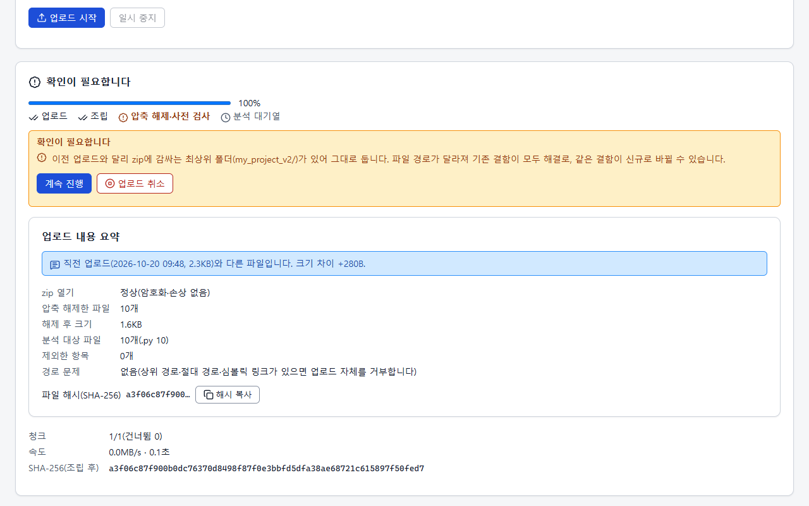 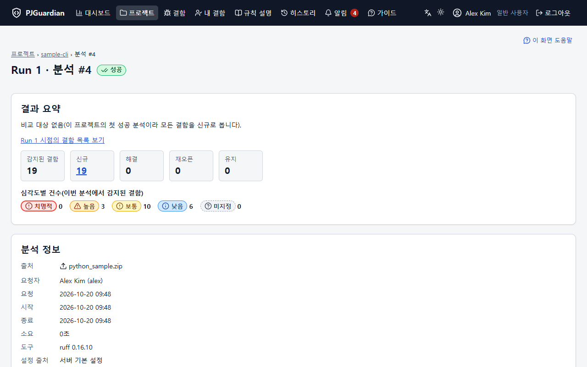

- **결함 추적**: 코드 내용으로 만든 시그니처로 결함을 식별하므로 줄이 밀려도 같은 결함으로 이어집니다. 다시 분석하면 사라진 결함은 자동으로 해결되고 다시 나타나면 재오픈됩니다. 담당자·심각도·상태 변경, 일괄 변경, 내 결함.

  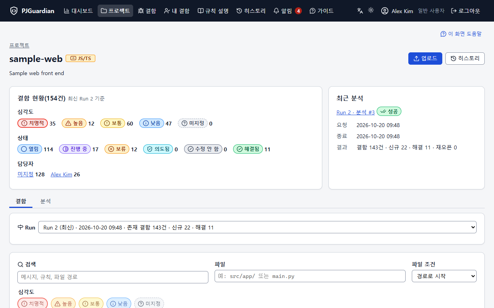

- **Run·히스토리·대시보드**: 성공한 분석마다 Run이 되며, 과거 Run을 읽기 전용으로 보고 직전 Run과 비교하며 대시보드에서 추이를 봅니다.

  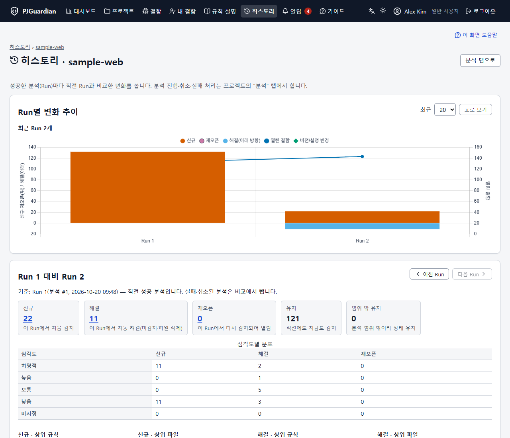

- **규칙**: 설치된 ruff·ESLint 버전의 규칙 설명, 자주 나오는 규칙의 쉬운 설명과 예시, 관리자의 규칙 켜기·끄기.

  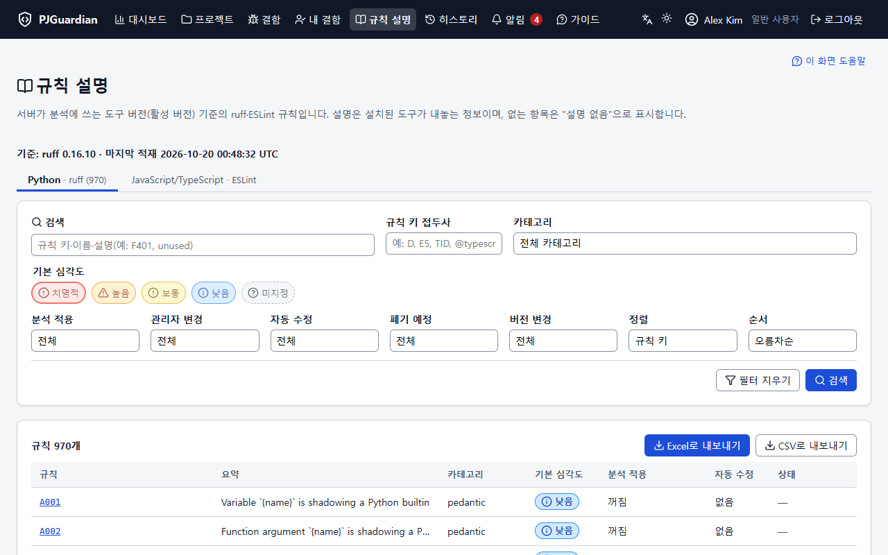

- **Git·Perforce**: 허용 호스트의 저장소에서 가져와 분석, 주기 분석, 변경 없음 감지.
- **운영**: 사용자·그룹·프로젝트별 접근 범위, LDAP/Active Directory와 SSO(OpenID Connect·SAML 2.0), 백업·복원, 시스템 모니터링과 `/health`, 관리자 장애 이메일, 변조를 알아챌 수 있는 감사 로그, 업그레이드 유지보수 모드.

  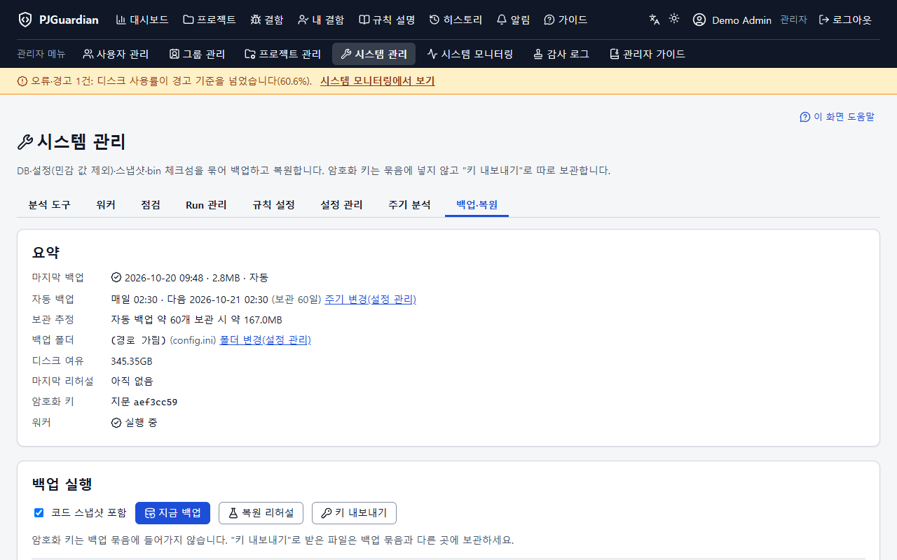 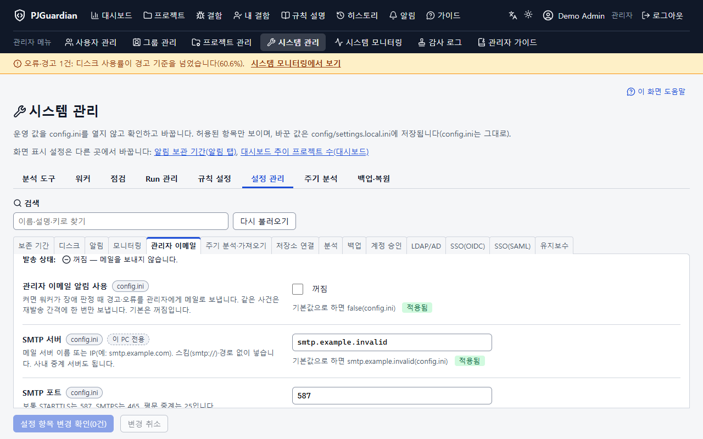

- **화면**: 한국어·영어, 라이트·다크 테마, 내장 사용자·관리자 가이드와 FAQ, CSV·Excel 내보내기.

  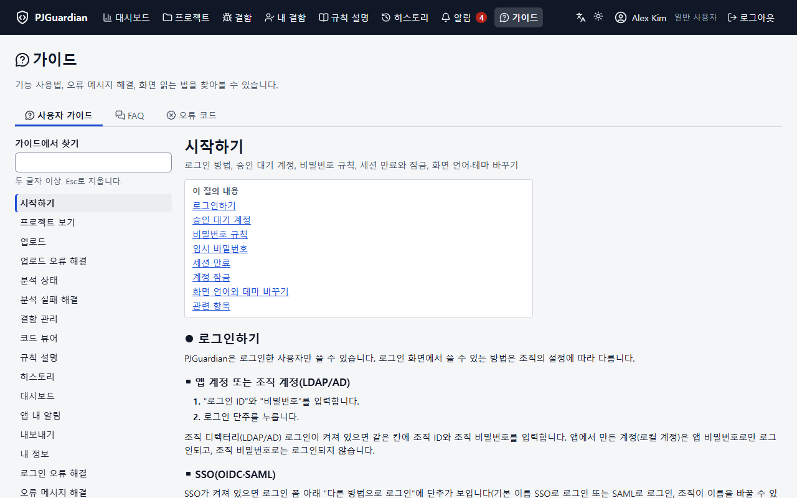

화면과 함께 보는 전체 소개는 [docs/features.ko.md](docs/features.ko.md)에 있습니다.

## 화면

<table>
  <tr>
    <td width="50%" valign="top"><b>대시보드</b> 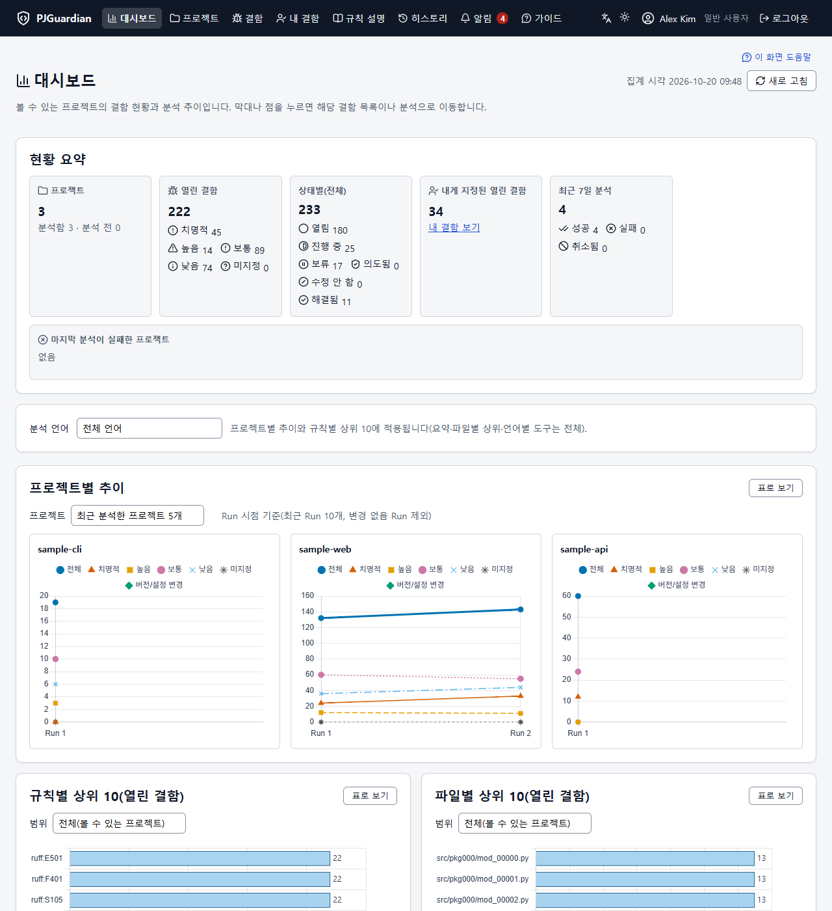</td>
    <td width="50%" valign="top"><b>결함</b> </td>
  </tr>
  <tr>
    <td width="50%" valign="top"><b>결함 상세와 코드 뷰어</b> 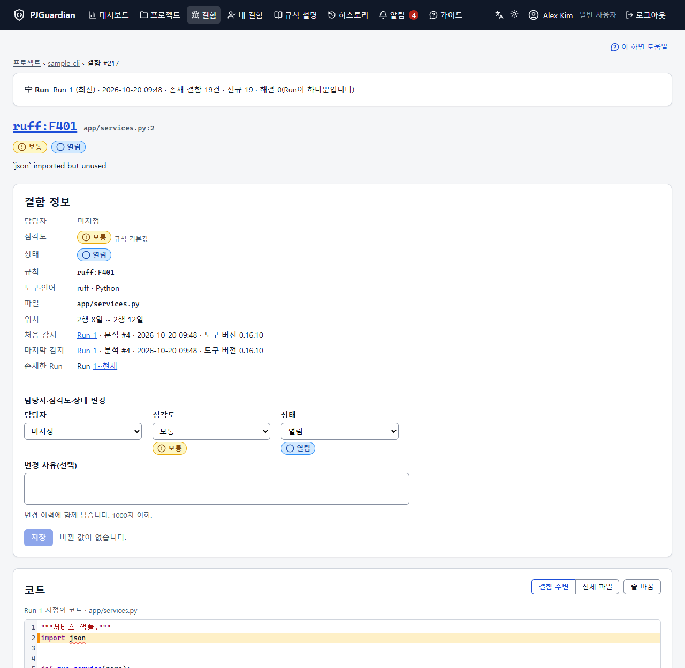</td>
    <td width="50%" valign="top"><b>시스템 모니터링</b> 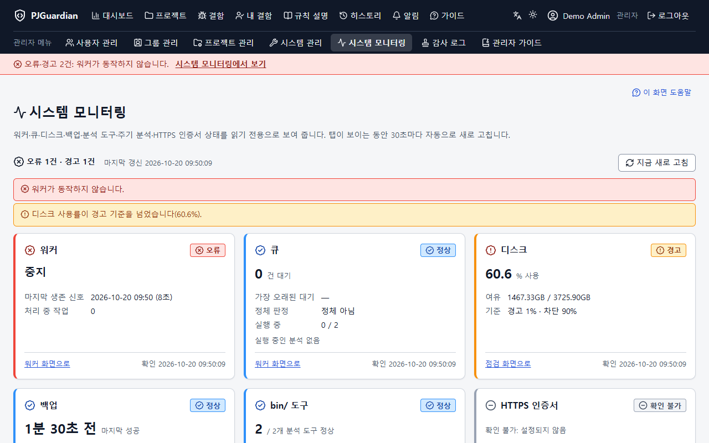</td>
  </tr>
  <tr>
    <td width="50%" valign="top"><b>감사 로그</b> 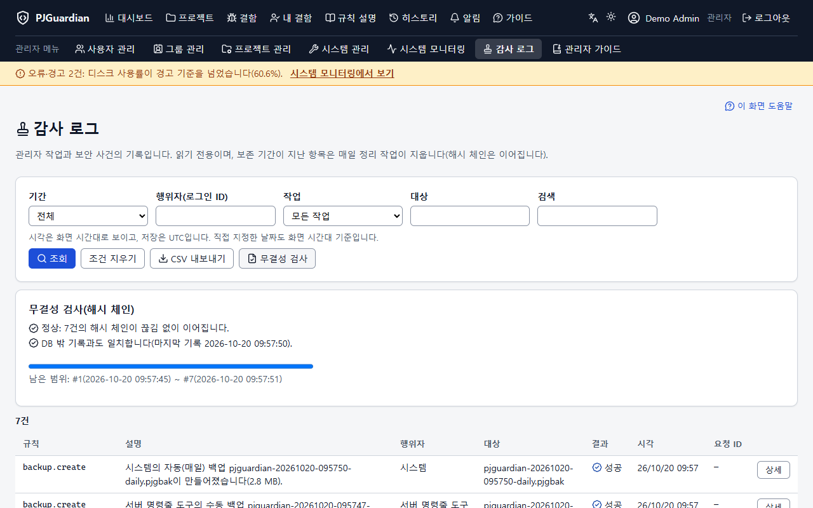</td>
    <td width="50%" valign="top"><b>다크 테마</b> 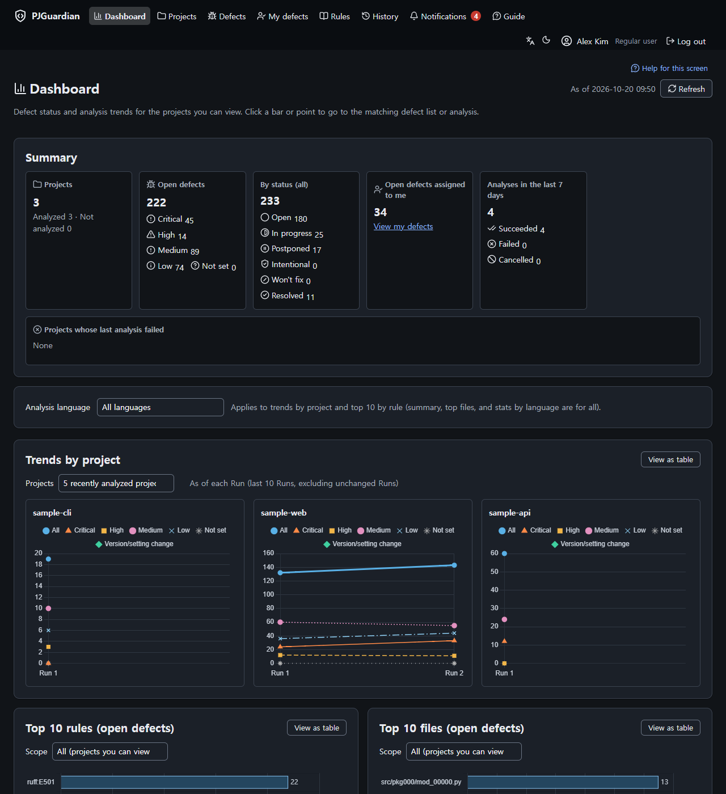</td>
  </tr>
</table>

그림은 모두 가상의 시연 데이터입니다.

## 요구 사항

| 구성요소 | 버전 |
| --- | --- |
| OS | Windows(확인함) 또는 Linux(아직 확인하지 않음 — [docs/unverified.md](docs/unverified.md)), macOS 미지원 |
| 웹 서버 | HTTPS를 쓰는 Apache 2.4(XAMPP 가능), `public/`만 웹에 노출 |
| PHP | 8.2 이상, 확장 `pdo_sqlite`·`zip`·`mbstring`·`openssl`·`fileinfo`·`intl`(LDAP 로그인을 쓰면 `ldap`) |
| SQLite | 3.38 이상(PHP에 포함) |
| Composer | PHP 라이브러리(SAML·이메일)를 `vendor/`에 설치 |
| Node.js | 20.19 이상(ESLint 실행) |
| 분석 도구 | ruff·ESLint를 체크섬 매니페스트와 함께 `bin/`에 둠 — [docs/bin_setup.md](docs/bin_setup.md) |

## 빠른 설치

1. 코드를 **웹 루트 밖**에 두고 `composer install --no-dev`를 실행한 뒤, Apache HTTPS 가상 호스트의 DocumentRoot를 `public/`으로 정합니다([docs/xampp_vhost.md](docs/xampp_vhost.md)).
2. `config/config.ini.example`을 `config/config.ini`로, `config/secrets.example`을 `config/secrets.ini`로 복사하고 `app.base_url`을 정한 뒤 `php tools/make_secret_key.php`를 실행합니다.
3. ruff·ESLint·Node.js를 준비하고([docs/bin_setup.md](docs/bin_setup.md)) `php tools/check_env.php`로 점검합니다.
4. DB와 최초 관리자를 만듭니다: `php tools/migrate.php`, `php tools/create_admin.php --login=admin --name="관리자"`.
5. 워커를 시작하고(`php tools/worker.php`, 예약 작업이나 서비스로 — [docs/worker_setup.md](docs/worker_setup.md)) 로그인한 뒤 **`admin` 비밀번호를 바꿉니다**.

자세한 내용: [docs/install_quick.ko.md](docs/install_quick.ko.md) · 영어: [docs/install_quick.en.md](docs/install_quick.en.md). 운영 전에는 [docs/hardening.md](docs/hardening.md)와 [docs/release_checklist.md](docs/release_checklist.md)를 따르세요.

## 문서

- [docs/README.md](docs/README.md) — 운영자·개발자 문서 목차
- 앱의 **가이드** 메뉴 — 사용자·관리자 가이드(한국어·영어)
- [CHANGELOG.md](CHANGELOG.md) — 변경 내역
- [docs/ci_status.md](docs/ci_status.md) — CI 상태

## 상태

버전 1.0.0. Windows + XAMPP에서 개발하고 시험했습니다. Linux, 실제 LDAP/AD·IdP, 실제 SMTP 서버는 아직 확인하지 않았습니다. 확인하지 않은 항목과 확인 방법은 [docs/unverified.md](docs/unverified.md)에 있습니다.

## AI 보조 개발

PJGuardian은 AI 코딩 도우미(Claude Code)의 도움을 받아 개발했습니다. 요구사항 정의, 단계별 검토, 시험·점검 실행, 커밋 결정은 사람이 했습니다. 자세한 내용은 [docs/legal/AI_ASSISTED.md](docs/legal/AI_ASSISTED.md)에 있습니다.

## 기여와 보안

이슈와 풀 리퀘스트를 환영합니다. 처음이라면 [CONTRIBUTING.md](CONTRIBUTING.md)부터 읽어 주세요. 보안 문제는 공개 이슈로 올리지 말고 아래 [SECURITY.md](SECURITY.md)의 방법으로 알려 주세요.

- [CONTRIBUTING.md](CONTRIBUTING.md) — 개발 환경, 시험, 규칙
- [SECURITY.md](SECURITY.md) — 취약점 제보 방법(공개 이슈로 올리지 마세요)
- [CODE_OF_CONDUCT.md](CODE_OF_CONDUCT.md)

## 라이선스와 고지

Copyright (c) 2026 resious71. PJGuardian은 [Apache License 2.0](LICENSE)입니다. 포함된 서드파티 소프트웨어는 [NOTICE](NOTICE)와 [THIRD_PARTY_NOTICES](THIRD_PARTY_NOTICES)에 있습니다.

- **무보증**: "있는 그대로" 제공하며, 정적 분석 도구의 결과를 보여 줄 뿐 코드 품질·보안을 보증하지 않습니다 — [docs/legal/DISCLAIMER.ko.md](docs/legal/DISCLAIMER.ko.md)
- **상표**: ruff·ESLint·Git·Perforce·GitHub 등은 각 소유자의 것이며 제휴 관계가 없습니다 — [docs/legal/TRADEMARKS.md](docs/legal/TRADEMARKS.md)
- **개인정보**: 텔레메트리 없음, 설치본이 저장하는 데이터와 외부 연결 — [docs/legal/PRIVACY.md](docs/legal/PRIVACY.md)
- **AI 보조 개발**: [docs/legal/AI_ASSISTED.md](docs/legal/AI_ASSISTED.md)
- **보안**: 초기 비밀번호 변경, HTTPS, `config/secrets.ini`와 백업 보호 — [SECURITY.md](SECURITY.md)
