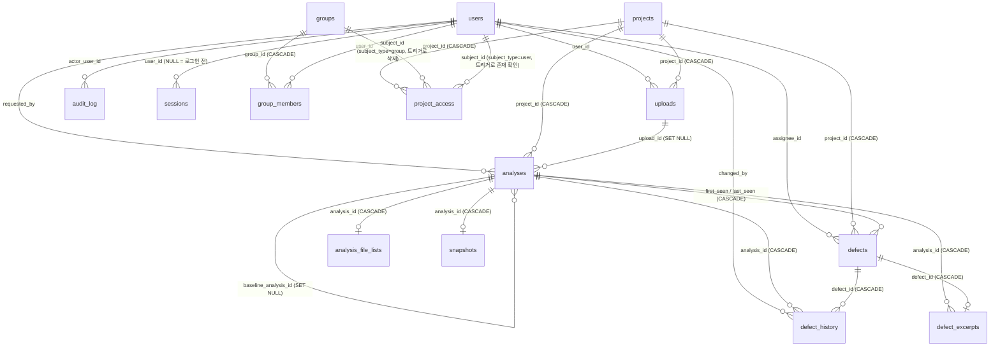
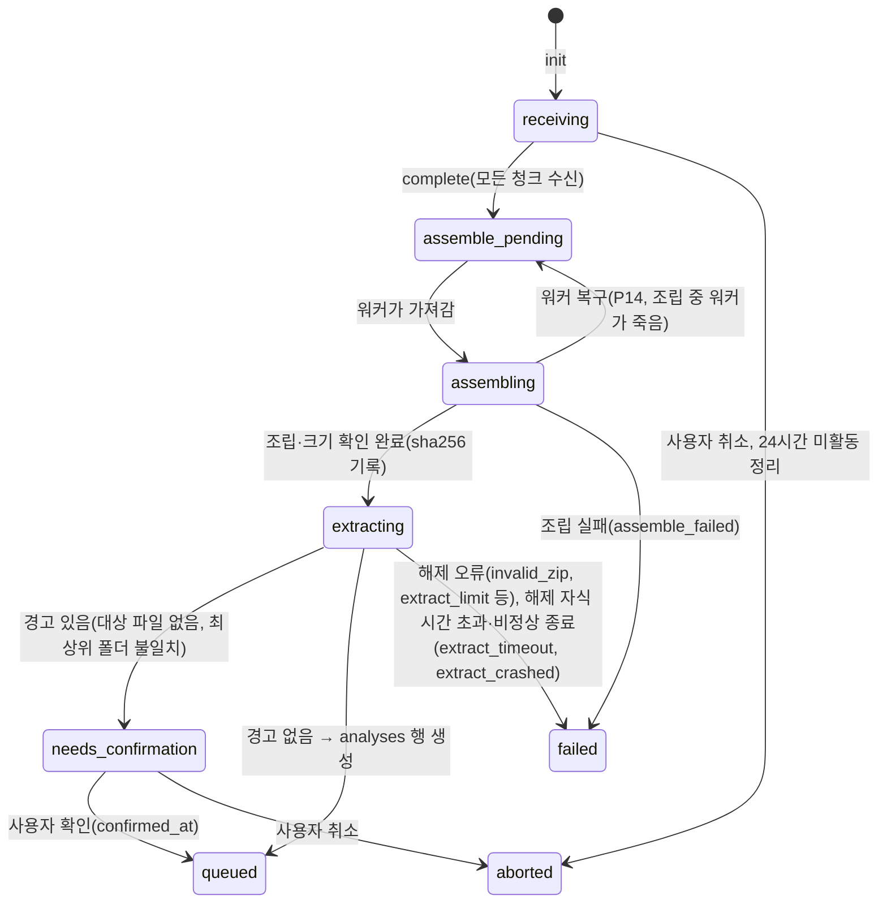
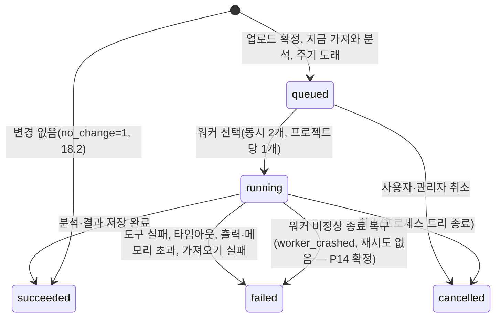

# PJGuardian DB 스키마 설계 (P08)

- 대상: 이번 묶음(P19까지)에 필요한 스키마 전체. 마이그레이션 `migrations/001_initial_schema.sql`
- 이후 단계가 추가할 테이블: 세션(P10), 알림(P24), 규칙 설명(P22), 저장소 연결·주기(P25·P26), 백업 이력(P30) 등
- 근거 문서: 명세 3~8·10·13·14·19.7·**19.10**, 프로토타입 결과(P04 시그니처·P05 zip 해제·P06 업로드 — `tools/proto/RESULTS_*.md`는 P32에서 지움, git 기록에 남음)
- 검증: `tests/Integration/{Migrator,Schema,SchemaQuery,IndexUsage}Test.php`, 참고 측정 `php tools/bench_schema.php`

## 1. 기본 규칙

| 항목 | 규칙 | 이유 |
| --- | --- | --- |
| 엔진 | SQLite(PDO), `journal_mode=WAL`, `synchronous=NORMAL`, `foreign_keys=ON`, `busy_timeout`(설정 `database.busy_timeout`, 기본 5초) | 명세 2·19.7. WAL로 웹(읽기)과 워커(쓰기)가 동시에 동작. foreign_keys는 접속마다 켜야 하므로 `Support\Db`가 켠다 |
| 쓰기 트랜잭션 | `BEGIN IMMEDIATE`, 짧게 | 쓰기 잠금을 처음에 잡아 "읽다가 쓰기로 올리는" 순간의 SQLITE_BUSY를 피한다 |
| 시간 | UTC ISO 8601 `TEXT`(`YYYY-MM-DDTHH:MM:SSZ`), 모든 시간 컬럼에 `GLOB` 형식 CHECK | 문자열 정렬 = 시간 순서. 형식이 섞이면 비교가 깨지므로 DB에서 막는다 |
| 불리언 | `INTEGER` 0/1 + CHECK | SQLite에 불리언 타입이 없음 |
| 열거형 | `TEXT` + `CHECK (x IN (...))` | 잘못된 값을 DB가 거부 |
| JSON | `TEXT` + `CHECK (json_valid(x) AND json_type(x) = 'array'|'object')` | 형식이 틀린 JSON 저장 방지 |
| 해시·ID | 길이와 16진수 CHECK(`length(x) = 64 AND x NOT GLOB '*[^0-9a-f]*'`) | 시그니처(64), upload_id(32), 작업 디렉토리(8) |
| 기본 키 | `INTEGER PRIMARY KEY AUTOINCREMENT`(분석·결함·이력·감사 로그) | 프로젝트 삭제로 행이 지워져도 번호를 다시 쓰지 않는다 → 등록 순서(큐 FIFO)와 링크가 항상 유일 |
| STRICT 테이블 | 쓰지 않음 | SQLite 3.37 이상 필요. Linux 배포판 PHP는 시스템 SQLite를 쓰는 경우가 많아 버전이 낮을 수 있다. 대신 CHECK 제약 |
| 최소 SQLite 버전 | **3.38 이상**(JSON 함수 기본 내장). 개발 PC: 3.39.2 | `json_valid` CHECK. 낮은 버전은 JSON1 확장이 있어야 함(설치 점검에 추가 필요, 9절) |

## 2. 테이블 목록과 관계

| 테이블 | 역할 | 행 수 규모(설계 기준) |
| --- | --- | --- |
| `schema_migrations` | 마이그레이션 적용 이력(버전, 이름, 파일 SHA-256, 적용 시각) | 수십 |
| `users` | 계정(로컬/LDAP), 역할, 잠금, 임시 비밀번호 | ≤ 1,000 |
| `login_failures` | IP 단위 로그인 실패 기록 | 최근 25분치(정리) |
| `sessions` | 로그인 세션(쿠키 ID의 해시), CSRF 토큰, 마지막 활동(P10, 002) | 동시 사용자 수 + 로그인 전 세션 |
| `projects` | 프로젝트, 언어(불변), 최상위 폴더 규칙, 추가 제외 패턴 | ≤ 200 |
| `uploads` | 청크 업로드 상태(업로드 후처리 큐 역할) | 진행 중 + 최근 |
| `analyses` | 분석 실행(분석 큐 역할), 도구·설정, 통계, 비교 기준 | 프로젝트당 수백 |
| `analysis_file_lists` | 분석별 적용 제외 규칙 + 대상 파일 목록(압축 BLOB) | 분석당 1행 |
| `snapshots` | 분석별 전체 스냅샷 파일 위치·정리 상태 | 분석당 1행 |
| `defects` | 결함(시그니처·순번으로 식별), 담당자·심각도·상태·version | 분석 1회당 ≤ 10만 |
| `defect_history` | 담당자·심각도·상태 변경 이력(수동/자동, 사유, 분석) | 결함 변경마다 |
| `defect_runs` | 결함의 존재 구간(Run from~to, to NULL = 지금까지)(P20R, 011) | 결함 수 + 닫혔다 다시 열린 횟수 |
| `defect_excerpts` | 전체 스냅샷이 정리된 결함의 주변 발췌(±20줄) | 오래된 결함 |
| `audit_log` | 관리자 작업 감사 로그(append-only, 해시 체인) | 90일치 |
| `audit_log_meta` | 해시 체인 기준점, 정리 허용 플래그(1행) | 1 |
| `tool_versions` | bin/ 도구 버전별 상태·체크섬·스모크 결과 | 수십 |
| `groups` | 사용자 그룹(한 단계, P11A · 005) | ≤ 수백 |
| `group_members` | 그룹 구성원과 그룹별 관리자 지정(P11A · 005) | 사용자 × 소속 그룹 |
| `project_access` | 프로젝트 접근 매핑(대상 = 그룹 또는 사용자, P11B · 006) | 프로젝트 × 매핑 수 |



- **프로젝트 삭제**(명세 4: 즉시 영구 삭제)는 `ON DELETE CASCADE`로 업로드·분석·파일 목록·스냅샷 행·결함·이력·발췌가 함께 지워진다. 디스크의 스냅샷·작업 파일은 서비스가 지운다. 감사 로그는 대상(`target_type`, `target_id`)을 문자열로 남기므로 지워지지 않는다.
- **사용자**는 삭제하지 않으므로(명세 13, 트리거로 금지) 사용자 외래 키는 `ON DELETE` 동작을 두지 않는다.

## 3. 테이블별 컬럼

### 3.1 `users` (명세 3, 13, 19.2)

| 컬럼 | 형식 | 설명 |
| --- | --- | --- |
| `id` | INTEGER PK | |
| `login_id` | TEXT UNIQUE, `COLLATE NOCASE` | 로그인 ID. 대소문자 구분 없이 유일(가정 A1) |
| `display_name` | TEXT | 표시 이름 |
| `email` | TEXT NULL | 이메일(관리자 장애 알림 등) |
| `role` | `admin` / `user` | 역할(명세 13) |
| `status` | `active` / `inactive` | 비활성 담당자는 결함에서 "비활성" 표시(명세 6.2) |
| `auth_type` | `local` / `ldap` | LDAP 계정은 비밀번호를 앱에 두지 않는다(CHECK) |
| `password_hash` | TEXT NULL | bcrypt(명세 3). local이면 필수, ldap이면 NULL(CHECK) |
| `temp_password_expires_at` | TEXT NULL | 임시 비밀번호 만료(발급 24시간 후, 명세 3·13). local만 |
| `must_change_password` | 0/1 | 임시 비밀번호로 로그인하면 변경 강제 |
| `failed_login_count` | INTEGER | 연속 실패 횟수(5회 → 잠금) |
| `locked_until` | TEXT NULL | 잠금 해제 시각(15분). 관리자·CLI 해제는 NULL로 |
| `password_kind` | TEXT `user`·`temporary`·`initial` (기본 `user`, 마이그레이션 003) | 현재 비밀번호의 발급 방식(X02). `initial` = 최초 관리자의 고정 초기 비밀번호(만료 없음, 변경 강제 없음 — 2026-10-13부터, 하드닝 점검 경고), `temporary` = 무작위 임시 비밀번호(24시간), `user` = 사용자 또는 관리자가 정함. 하드닝 점검이 `initial`인 활성 관리자를 경고한다 |
| `admin_password_set_at` | TEXT NULL(UTC ISO, 마이그레이션 004) | 관리자가 사용자 관리 화면에서 비밀번호를 정한 시각(명세 13장). 다음 로그인 성공 때 알림을 한 번 보여 주고 NULL로 비운다. 변경은 강제하지 않는다 |
| `created_at`, `updated_at` | TEXT | |

트리거: `users_no_delete`(삭제 금지), `users_keep_last_active_admin`(마지막 활성 관리자를 비활성화·강등하면 거부, 명세 13).

### 3.2 `login_failures` (명세 3, 19.5)

`ip`, `failed_at`. 차단 판정: `(ip, failed_at)` 인덱스로 그 IP의 최근 20건만 읽어, 20건이 있고 가장 오래된 것과 가장 최근 것의 간격이 10분 이내면 **차단 해제 시각 = 가장 최근 실패 + 15분**. 수치는 설정 `auth.ip_*`. 25분(창 + 차단)보다 오래된 행은 정리 작업(P14)이 지운다. 계정 단위 잠금은 `users.failed_login_count`·`locked_until`.
P10 구현: 차단 중의 시도는 기록하지 않는다(차단이 끝없이 늘지 않게). 실패를 기록할 때 같은 IP의 25분보다 오래된 행을 함께 지운다.

### 3.2a `sessions` (명세 3, 13, P10 · 마이그레이션 002)

| 컬럼 | 형식 | 설명 |
| --- | --- | --- |
| `id_hash` | TEXT PK(64자리 16진수) | 쿠키 값(32바이트 난수의 base64url)의 SHA-256. 원래 ID는 서버에 남기지 않는다(DB가 유출돼도 세션을 가로챌 수 없음) |
| `user_id` | INTEGER NULL → users | NULL이면 로그인 전 세션(로그인 폼의 CSRF 토큰용) |
| `csrf_token` | TEXT(64자리 16진수) | 세션에 묶인 CSRF 토큰. 로그인하면 세션과 함께 새로 만든다 |
| `created_at`, `last_activity_at` | TEXT(UTC ISO) | 만료 판정은 `last_activity_at`(30분 무활동, `auth.session_idle`). 갱신은 `auth.session_touch_interval`(60초) 이내면 건너뛴다 |
| `ip`, `user_agent` | TEXT NULL | 참고용(최대 45자, 255자) |
| `flash` | TEXT NULL(JSON 객체, 마이그레이션 004) | 다음 화면에 한 번 보여 줄 알림(예: `{"code":"password_set_by_admin","at":"…"}`). 로그인 후 이동한 화면이 꺼내고 비운다 |

인덱스: `sessions_user(user_id)`(사용자 세션 일괄 폐기: 비활성화·역할 변경·임시 비밀번호 발급·비밀번호 변경), `sessions_activity(last_activity_at)`(만료 정리). 만료 행은 조회할 때, 로그인할 때(`purgeExpired`), 정리 작업(P14)이 지운다.

### 3.2b `groups`, `group_members` (명세 3.1, P11A · 마이그레이션 005)

`groups`

| 컬럼 | 형식 | 설명 |
| --- | --- | --- |
| `id` | INTEGER PK AUTOINCREMENT | 지운 그룹의 id를 다시 쓰지 않는다(감사 로그 대상 id와 혼동 방지) |
| `name` | TEXT UNIQUE `COLLATE NOCASE`, 1~100자 | 앞뒤 공백 제거, 제어 문자 불가(서비스 검사) |
| `description` | TEXT, 2000자 이하 | 기본 '' |
| `created_at`, `updated_at` | TEXT(UTC ISO) | |
| `created_by` | INTEGER NULL → users | 만든 admin |

`group_members` (`WITHOUT ROWID`, PK `(group_id, user_id)`)

| 컬럼 | 형식 | 설명 |
| --- | --- | --- |
| `group_id` | INTEGER → groups `ON DELETE CASCADE` | 그룹을 지우면 소속도 사라진다. 사용자 계정은 그대로 |
| `user_id` | INTEGER → users | 사용자는 삭제하지 않으므로 연쇄 없음. 비활성 사용자의 행은 남는다(화면에 "비활성" 표시) |
| `is_manager` | INTEGER 0/1 | 그룹 관리자는 시스템 역할이 아니라 **그룹별 지정**이다 |
| `added_at`, `added_by` | TEXT(UTC ISO), INTEGER NULL → users | |

- admin(`users.role = 'admin'`)은 모든 그룹의 관리자로 간주하며 구성원 행을 만들지 않는다(서비스가 `admin_implicit_member`로 거부).
- 인덱스 `group_members_user(user_id, is_manager)`: 내가 관리하는 그룹(`GroupPermission`), 사용자별 소속 그룹 이름(사용자 관리 화면), 프로젝트 접근 판정(P11B).
- 프로젝트 매핑(`project_access`)은 P11B가 추가한다.

### 3.2c `project_access` (명세 3.1, 19.10, P11B · 마이그레이션 006)

| 컬럼 | 형식 | 설명 |
| --- | --- | --- |
| `id` | INTEGER PK AUTOINCREMENT | |
| `project_id` | INTEGER → projects `ON DELETE CASCADE` | 프로젝트를 지우면 매핑도 사라진다 |
| `subject_type` | TEXT `CHECK IN ('group','user')` | 매핑 대상 종류 |
| `subject_id` | INTEGER | `subject_type`에 따라 groups.id 또는 users.id. 외래 키 하나로 표현할 수 없어 **트리거로 보장**한다 |
| `created_at`, `created_by` | TEXT(UTC ISO), INTEGER NULL → users | 매핑한 시각·관리자 |

- 고유: `UNIQUE(project_id, subject_type, subject_id)`. 인덱스 `project_access_subject(subject_type, subject_id, project_id)`(대상 쪽 조회: 사용자가 볼 수 있는 프로젝트, 그룹의 매핑 수).
- 트리거: `project_access_subject_exists`(삽입 때 대상이 없으면 거부), `project_access_no_update`(행은 추가·삭제만), `groups_delete_project_access`(그룹을 지우면 그 그룹의 매핑 삭제). 사용자는 삭제하지 않으므로(users_no_delete) 사용자 쪽 삭제 트리거는 두지 않는다.
- **볼 수 있는 사람**: 활성 admin + 직접 매핑된 사용자 + 매핑된 그룹의 구성원. 매핑이 없으면 admin만(기본 비공개). 판정은 `Services\ProjectAccess` 한 곳(docs/architecture.md 19절).
- 006은 기존 프로젝트에 매핑을 만들지 않는다. P11까지 만든 프로젝트는 적용 후 admin만 본다.

### 3.3 `projects` (명세 4, 19.10)

| 컬럼 | 설명 |
| --- | --- |
| `name` | 유일(`COLLATE NOCASE`, 가정 A1) |
| `description` | 관리자가 수정 |
| `language` | `python` / `javascript`. **변경 불가**(트리거 `projects_language_immutable`) |
| `strip_top_folder` | NULL = 미확정(첫 업로드 전), 1 = 제거, 0 = 유지(명세 19.10). 첫 업로드에서 `UPDATE ... WHERE strip_top_folder IS NULL`로 한 번만 정한다 |
| `exclude_patterns` | 관리자가 추가한 제외 패턴(JSON 배열). 서버 기본 목록은 설정 `extract.default_excludes` |

저장소 연결 컬럼은 P25 마이그레이션이 추가한다.

### 3.4 `uploads` (명세 5.1, 5.4, 19.3, 19.10)

| 컬럼 | 설명 |
| --- | --- |
| `id` | 서버가 만든 32자리 16진수(CHECK). 업로드 파일 폴더 `data/uploads/<id>/`(청크 `<n>.part`, 청크 해시 `<n>.sha256`, `.lock`, 조립본 `upload.zip`)의 유일한 경로 요소(P12) |
| `user_id`, `project_id` | 업로드한 사용자(다른 사용자에게는 404로 숨김, 19.10), 대상 프로젝트 |
| `file_name` | 표시용. 경로에 쓰지 않는다 |
| `total_size`, `chunk_size`, `total_chunks` | `init` 시점 값. 받은 청크 목록은 디스크의 청크 파일이 원본(P06 방식) |
| `status` | 6절 상태 전이 |
| `reserved_bytes` | 디스크 사전 검사용 예약 크기(19.10: 진행 중 업로드의 예약 합산). **S + max(S, 해제 상한)**(P12, `DiskGuard`). 끝 상태(queued·failed·aborted)가 되면 0 |
| `sha256` | 조립본 SHA-256(조립 후 필수, CHECK) |
| `work_dir` | 해제 작업 디렉토리 이름(8자리 16진수, 19.10) |
| `warnings` | 사용자 확인이 필요한 경고 코드(JSON 배열: `no_target`, `top_folder_missing`, `top_folder_kept`, P13) |
| `confirmed_at` | 사용자가 경고를 확인한 시각(가정 A4) |
| `error_code`, `error_message` | 실패 사유(명세 15.2의 업로드 오류 코드) |
| `last_activity_at` | 마지막 청크·상태 변경. 미완료 조각 24시간 정리 기준 |

### 3.5 `analyses` (명세 5.2, 5.3, 8, 12, 18, 19.8, 19.10)

| 컬럼 | 설명 |
| --- | --- |
| `id` | AUTOINCREMENT. **큐의 등록 순서** |
| `project_id`, `upload_id` | 업로드 출처면 upload_id(업로드 행이 정리되면 NULL) |
| `status` | `queued` / `running` / `succeeded` / `failed` / `cancelled`(명세 5.2) |
| `source_kind`, `source_ref`, `source_revision` | upload / git(브랜치, 커밋) / perforce(depot 경로, changelist)(명세 18.3) |
| `trigger_kind`, `requested_by` | user(요청자 필수) / schedule(요청자 NULL)(CHECK) |
| `tool`, `tool_version` | 실제 사용 버전(명세 12) |
| `config_source`, `config_hash`, `ignored_configs` | 설정 출처·해시, 무시된 설정과 사유(JSON) → "설정 무시됨"·"버전/설정 변경" 배지 |
| `cancel_requested` | 취소 요청(워커가 확인해 프로세스 트리 종료) |
| `queued_at`, `started_at`, `finished_at` | 상태별 필수(CHECK) |
| `failure_code`, `failure_message` | failed면 코드 필수(CHECK) |
| `total_count`, `new_count`, `resolved_count`, `reopened_count`, `unchanged_count` | 결함 통계. 성공(변경 없음 제외)이면 필수(CHECK) |
| `severity_counts` | 이번 분석에서 감지된 결함의 심각도별 건수(JSON 객체) |
| `assembled_sha256` | 조립본 SHA-256(19.10) |
| `baseline_analysis_id` | 분석 시점의 직전 성공 분석. NULL = 비교 대상 없음 |
| `no_change` | 명세 18.2 "변경 없음"(같은 커밋·changelist). status=succeeded로 기록(가정 A2) |
| `work_dir` | 분석 대상 작업 디렉토리(8자리) |
| `worker_pid`, `process_group_id` | 취소·비정상 종료 복구(명세 5.4, 14) |
| `run_number`, `run_history_mark`, `run_summary` | Run 번호·종료 표지·Run 요약(마이그레이션 011, 5.0b) |
| `run_detail_deleted_at`, `run_detail_deleted_by`, `run_detail_deleted_reason` | Run 상세 삭제 표식(마이그레이션 013, P21B, 5.0e). 셋 다 NULL = 상세 있음. `manual`(admin, 삭제한 사용자 필수) / `retention`(자동 보관, 사용자 NULL). Run 번호가 있는 행만(CHECK) |

부분 고유 인덱스 `analyses_one_running_per_project`: 같은 프로젝트의 running은 하나만(명세 5.4)을 DB가 보장한다.

### 3.6 `analysis_file_lists` (명세 19.10)

`analysis_id`(PK), `exclude_rules`(실제 적용한 제외 규칙 JSON 객체 `{"server_default":[이름], "project":[패턴], "config_files":[무시한 업로드 설정 파일]}`), `file_count`, `encoding`(`zlib-lines-v1`: 정렬한 NFC 경로를 `\n`으로 이어 `gzcompress`), `files_blob`.
- 목록 = **도구가 실제로 분석한 파일**(ruff `--show-files`, ESLint 결과의 모든 파일, P16). 삭제(`file_deleted`)와 범위 밖(업로드 설정의 제외)을 가르는 입력이다.
- **길이 0인 BLOB(`x''`) = "정리됨(목록 없음)"**. 스냅샷 정리와 함께 최근 5회(`snapshot.full_keep_count`) 성공 분석 밖의 BLOB을 비운다(`file_count`·`exclude_rules`는 남김). 조회 코드(`ScopeList::decode`)는 빈 BLOB이면 null. NOT NULL이지만 길이 CHECK가 없어 마이그레이션 없이 쓸 수 있다.

### 3.7 `snapshots` (명세 7, 14)

`analysis_id`(PK), `storage_path`(snapshots_dir 기준 `"<프로젝트 id>/<분석 id>"`), `size_bytes`, `file_count`, `status`(`full` / `pruned`), `created_at`, `pruned_at`.
- 형식(P16 확정): 그 폴더의 `source.zip` 한 파일(Deflate, 항목 = 분석 범위 파일의 NFC 상대 경로). 단일 보관 파일이라 Windows 경로 길이·파일 수 문제가 없다. 대상 파일이 0개인 분석은 행이 없다.

### 3.8 `defects` (명세 6.1, 6.2, 19.10)

| 컬럼 | 설명 |
| --- | --- |
| `signature`, `ordinal` | **고유 키 `(project_id, signature, ordinal)`** |
| `tool`, `language` | ruff↔python, eslint↔javascript/typescript(CHECK) |
| `rule_key` | `ruff:F401`, `eslint:no-unused-vars`, `syntax-error` |
| `file_path`, `line_no`, `col_no`, `end_line_no`, `end_col_no`, `message` | **마지막으로 감지된 분석** 기준 값으로 갱신 |
| `severity` | 기본 `not_defined`(5값 CHECK). P21S부터 분석이 만든 신규 결함은 규칙 기본 심각도(`docs/severity_mapping.md`) |
| `severity_source` | 심각도 출처(마이그레이션 012, P21S): `none`(부여된 적 없음) / `auto`(규칙 기본 심각도 매핑이 부여) / `manual`(사람이 바꿈, not_defined로 바꾼 것 포함). 기본 `none`. 분석·일괄 채움은 manual을 바꾸지 않는다 |
| `status` | 기본 `open`(6값 CHECK). 상태 전이 제약은 두지 않는다(명세 6.2 자유 변경) |
| `assignee_id` | 담당자(활성 사용자만 지정하는 규칙은 서비스, 비활성화돼도 유지) |
| `version` | 낙관적 잠금(사용자 수정·자동 전환마다 +1) |
| `first_seen_analysis_id`, `last_seen_analysis_id` | 처음·마지막 감지 분석(`last ≥ first` CHECK) |

정규화 코드 원문은 저장하지 않는다(19.10: 해시만 보관).

### 3.9 `defect_history` (명세 6.2, 6.3)

| 컬럼 | 설명 |
| --- | --- |
| `field` | `assignee` / `severity` / `status` |
| `old_value`, `new_value` | 문자열(담당자는 사용자 id) |
| `changed_by` | 변경자. 자동이면 NULL |
| `kind` | `manual` / `auto` |
| `reason_code` | 자동 전환 사유: `not_detected`, `file_deleted`, `redetected`. `still_detected`는 **사용하지 않음**(CHECK 제약에는 값이 남아 있으나 쓰지 않는다, P20A 결정). `rule_default` = 규칙 기본 심각도 일괄 적용(012, P21S) |
| `memo` | 사용자가 입력한 사유(선택). rule_default면 "규칙 기본 심각도 적용(매핑 ruff v1)" |
| `analysis_id` | 자동 전환을 일으킨 분석 |

CHECK: manual이면 변경자 필수·사유 코드와 분석 없음. auto는 둘 중 하나 — ① field=status·상태 사유 4종·분석 필수(분석의 자동 전환) ② field=severity·`rule_default`·분석 없음(규칙 기본 심각도 일괄 적용, `tools/severity_apply.php`, 012에서 추가).

**012에서 표를 다시 만들었다**(SQLite는 CHECK를 바꿀 수 없음): 같은 열·같은 id(복사)·같은 인덱스 3개(`defect_history_defect`, `defect_history_analysis`, `defect_history_field`). id를 그대로 옮겨 Run 종료 표지(`analyses.run_history_mark`)가 그대로 맞고, AUTOINCREMENT 순번도 이어진다(시험: `SeverityDefaultTest`). 이 표를 참조하는 표·트리거·뷰는 없다.

**되돌리기(012)**: ① `DELETE FROM defect_history WHERE reason_code = 'rule_default'` 뒤 001의 정의(CHECK)로 같은 방법(새 표 → 복사 → 이름 바꾸기 → 인덱스)으로 다시 만들고 ② `defects.severity_source`는 남겨 두어도 이전 코드와 호환된다(이전 코드는 이 열을 읽지 않는다. 지우려면 `ALTER TABLE defects DROP COLUMN severity_source`, SQLite 3.35 이상) ③ `schema_migrations`에서 012 행을 지운다. 이미 채운 심각도 값은 이력의 old_value로 되돌릴 수 있다.

### 3.10 `defect_excerpts` (명세 7)

결함당 하나: `analysis_id`(발췌 원본 = 그 결함의 마지막 감지 분석), `file_path`, `start_line`, `end_line`, `content`(UTF-8 텍스트). 그 분석의 스냅샷이 정리될 때 만들고, 결함이 더 새 분석에서 다시 감지되면 지운다.

- `content_replaced`(마이그레이션 007, P16): 원본 소스가 UTF-8이 아니어서 대체 문자(U+FFFD)로 바꿔 저장했으면 1. 상세 화면(P17)이 표시한다.
- `analysis_id` = 발췌한 스냅샷의 분석(= 그 결함의 마지막 감지 분석). 결함이 더 새 분석에서 다시 감지되면 발췌를 지운다.

### 3.11 `audit_log`, `audit_log_meta` (명세 10, 13, 18.4, 19.7)

`occurred_at`, `actor_user_id`(CLI·시스템이면 NULL), `actor_label`(당시 로그인 ID 또는 `cli`/`system`), `action`, `target_type`, `target_id`, `details`(JSON, 비밀번호 마스킹), `ip`, `prev_hash`, `hash`(유일).
- 결함 자동 전환 이력(`defect_history`, P16): `kind = 'auto'`, `changed_by` NULL, `analysis_id` = 전환을 일으킨 분석, `reason_code` = `not_detected`·`file_deleted`(→ resolved) / `redetected`(→ open). 이전 상태는 `old_value`에 남고 결함 `version`이 1 오른다.
- `user.update`(X05 사용자 정보 수정)의 `details`: `{"actor_role":"admin"|"user","self":true|false,"display_name":{"from","to"},"email":{"from","to"}}` — 바뀐 항목만, **이메일은 `a***@도메인`으로 가린다**(평문 저장 금지). 스키마 변경 없음(`users.display_name`, `users.email`을 그대로 쓴다).
- `hash = SHA-256(prev_hash \n occurred_at \n actor_user_id \n actor_label \n action \n target_type \n target_id \n details \n ip)`. 계산과 검증은 `Support\AuditChain`.
- 트리거: UPDATE는 항상 거부. DELETE는 `audit_log_meta.purge_enabled = 1`일 때만 허용(보존 기간 정리 전용, 4.6절).
- `audit_log_meta`(1행): `anchor_hash`(남은 첫 행의 prev_hash), `purged_through`, `purge_enabled`. 이 행은 지울 수 없다.

### 3.12 `tool_versions` (명세 12, 19.1)

`tool`(ruff/eslint/git/p4), `version`, `os`, `status`(`active` / `blocked` / `pinned` / `invalid`), `checksum_ok`·`checksum_checked_at`, `smoke_ok`·`smoke_checked_at`·`smoke_message`, `detected_at`, `updated_at`. `UNIQUE(tool, version, os)`, 도구·OS별 pinned는 하나(부분 고유 인덱스), active·pinned는 체크섬·스모크 통과 필수(CHECK).
마이그레이션 009(P20A): `removal_requested_at`(웹의 삭제 예정 표시, 선택에서 제외), `removed_at`(CLI `remove`가 폴더를 지운 시각, 행은 이력으로 남김). 상태 CHECK는 바꾸지 않았다(열만 추가).

### 3.12a `admin_tasks` (P20A · 마이그레이션 009)

관리 작업 요청. `kind`(`tool_verify` / `cleanup_run` / `disk_scan`), `target`(tool_verify는 `<도구>@<버전>`, 그 밖은 `''`), `status`(`queued` → `running` → `succeeded` / `failed`), `requested_by`, `result`(JSON 객체, 서버 경로·비밀값 없음), `created_at`·`started_at`·`finished_at`(상태와 일치 CHECK). 부분 고유 인덱스 `(kind, target) WHERE status IN ('queued','running')` = 같은 요청은 하나(중복 합침). 웹은 넣기만, 워커가 자식 `tools/run_admin_task.php`로 실행.

### 3.12b `tool_staging` (P20A · 마이그레이션 009)

도구 설치 패키지 스테이징. `id`(32자리 16진수, 폴더 이름), `tool`(ruff/eslint), `file_name`(표시용), `total_size`·`received_bytes`·`chunk_size`·`total_chunks`, `status`(`receiving` → `staged` → `installing` → `installed` / `install_failed`, 언제든 `discarded`), `sha256`(complete에서 계산), `expected_sha256`(관리자가 넣은 배포처 해시), `result`(CLI 설치 결과 JSON), `uploaded_by`, `created_at`, `updated_at`. 파일은 `<work_dir>/tool_staging/<id>/`(package.zip, result.json).

### 3.12c `app_settings` (P21C · 마이그레이션 014)

화면에서 admin이 바꾸는 전체 공통 표시 설정(키-값). `key`(PK, `영문.영문` 형식 64자 이하), `value`(문자열 1000자 이하, 형식·범위는 코드 `AppSettings::SCHEMA`가 검사), `updated_by`(사용자, 삭제되면 NULL), `updated_at`. 행이 없으면 코드의 기본값. 첫 키 `dashboard.trend_projects`(1~50, 기본 5).

같은 014에서 `uploads.summary`(TEXT NULL, `json_valid`)를 더했다: 업로드 내용 요약(해제 결과의 숫자·직전 업로드 비교). 분석이 성공하면 업로드 폴더(`extract.json`)가 바로 지워지므로 결과 화면용으로 DB에 남긴다. 기존 행은 NULL.

되돌리기: `DROP TABLE app_settings`, `ALTER TABLE uploads DROP COLUMN summary`(SQLite 3.35 이상) + `schema_migrations`의 014 행 삭제.

### 3.14 규칙 설명 (P22 · 마이그레이션 015)

- `rule_versions (tool, version)` PK: `components`(JSON, 예: `@typescript-eslint/eslint-plugin` 버전), `is_active`(도구당 하나, 부분 고유 인덱스), `baseline`(가장 오래된 적재 버전 = 변경 내역 없음), `rule_count`, `severity_map_version`, `content_hash`, `loaded_at`.
- `rules`: (tool, version, rule) 유일. name, summary, description(마크다운 원문), category, origin(ruff linter·ESLint 플러그인), default_enabled(서버 기본 설정에서 켜짐), fixable(none/sometimes/always), has_suggestions, has_options, status(stable/preview/deprecated/removed), deprecation(JSON), docs_url(https만), severity·severity_level·severity_reason(P21S), enrichment(보강 출처 JSON), content_hash. 인덱스 `rules_rule (tool, rule, version)`.
- `rules_fts`: FTS5(trigram, 외부 내용 = rules). 적재 뒤 `rebuild`.
- `rule_changes`: tool, from_version, to_version, rule, kind(added/removed/renamed/description/default_enabled/default_severity/deprecated/fixable), before, after. 인덱스 (tool, rule, to_version), (tool, to_version, kind).
- 015는 `admin_tasks`를 다시 만들어 kind에 `rules_load`를 더했다(같은 열·같은 id·같은 인덱스 2개, AUTOINCREMENT 이어짐 — 시험 RuleLoadTest).
- 결함이 가리키는 규칙의 상태(활성 버전에 있는지)는 저장하지 않고 조회로 판정한다(`RuleQuery::missingIn`, 결함 rule_key의 접두사를 떼어 활성 버전 rules와 대조).
- 되돌리기: 네 표 삭제(`DROP TABLE rule_changes; DROP TABLE rules_fts; DROP TABLE rules; DROP TABLE rule_versions;`), `admin_tasks`는 rules_load 행을 지우고 009 정의로 같은 방법으로 다시 만들기, `schema_migrations`의 015 행 삭제.

### 3.15 관리자 규칙 켜기·끄기 (P22B · 마이그레이션 016)

- `rule_overrides (tool, rule)` PK: 관리자가 바꾼 규칙만(기본값과 같아지면 행 삭제 — 저장은 차이만). `enabled`(1 켬 / 0 끔), `base_enabled`·`tool_version`(변경 시점 기록), `reason`(200자 이하, 선택), `changed_by`(users, 지우면 NULL), `changed_at`. 규칙 키는 P22 표기(도구 접두사 없음).
- `rule_override_state (tool)` PK: `revision`(변경마다 +1 — 화면·API 최신 확인), `updated_at`(마지막 변경). 016이 ruff·eslint 두 행을 넣는다.
- `rule_enable_blocks (tool, version, rule, reason)` PK: 켤 수 없는 규칙(버전별) — `requires_type_info`(ESLint meta.docs.requiresTypeChecking), `requires_options`(resources/rules/requires_options.json). 규칙 데이터 적재 때마다 버전별로 다시 쓴다(내용 해시와 무관, rules의 내용 해시·변경 내역에는 넣지 않음). FK (tool, version) → rule_versions ON DELETE CASCADE. 상태로 막는 경우(removed·deprecated·preview)는 `rules.status`로 판정한다.
- 기존 표는 바꾸지 않는다. 표가 없거나 행이 없으면 분석·설정 해시가 지금과 같다(`RuleOverrides::available`, `RuleQuery`도 016 전 DB를 견딘다).
- 되돌리기: `DROP TABLE rule_enable_blocks; DROP TABLE rule_override_state; DROP TABLE rule_overrides;` + `schema_migrations`의 016 행 삭제(관리자 변경이 사라지고 다음 분석부터 서버 기본 설정만 — 해시가 기본으로 돌아가 "설정 변경"으로 보인다).

### 3.16 앱 안 알림 (P24 · 마이그레이션 017)

- `notifications`: id, `user_id`(받는 사람, users ON DELETE CASCADE), `kind`(CHECK 5종: analysis_done·analysis_failed·defect_assigned·defect_changed·analysis_summary),
  `project_id`(projects ON DELETE CASCADE — 프로젝트를 지우면 알림도 지운다), `analysis_id`·`defect_id`(이동 대상 참고값, FK 없음), `params`(JSON 객체, 2,000바이트 이하 —
  건수·Run 번호·상태값·실패 코드만. 결함 메시지·파일 경로·소스·프로젝트 이름은 넣지 않는다), `dedupe_key`(120자 이하), `created_at`, `read_at`(NULL = 안 읽음).
  **(user_id, dedupe_key) 유일**(같은 사건은 한 번만 — INSERT OR IGNORE).
- 인덱스: `notifications_user_read_created (user_id, read_at, created_at DESC)` — 안 읽은 개수·안 읽은 목록, `notifications_user_created (user_id, created_at DESC, id DESC)` — 전체 목록,
  `notifications_read_at (read_at) WHERE read_at IS NOT NULL`·`notifications_created (created_at)` — 보관 정리, `notifications_project (project_id) WHERE project_id IS NOT NULL` — 프로젝트 삭제 CASCADE.
- `notification_prefs (user_id, kind)` PK(WITHOUT ROWID): `enabled`(0/1), `updated_at`. 기본(켜짐)과 다른 행만 저장한다(사실상 꺼진 종류만). users ON DELETE CASCADE.
- 사용자 행은 지우지 않으므로(트리거) 사용자 FK의 CASCADE는 안전망이다(014·016이 SET NULL을 둔 것과 같은 방식). 접근을 잃은 프로젝트의 알림은 행을 두고 조회에서 숨긴다.
- 보관 기간·상한은 표가 아니라 `app_settings`의 `notifications.retain_read_days`(7)·`retain_unread_days`(30)·`max_per_user`(1000) — 행이 없으면 기본값.
- 기존 표·데이터는 바꾸지 않는다. 017 전 DB에서는 알림을 만들지 못하고 경고 로그만 남기며(분석·결함 변경은 정상), 안 읽은 개수 API는 0을 준다.
- 되돌리기: `DROP TABLE notification_prefs; DROP TABLE notifications;` + `schema_migrations`의 017 행 삭제(선택: `DELETE FROM app_settings WHERE key LIKE 'notifications.%'`).

### 3.17 소스 저장소 연동 (P25 · 마이그레이션 018)

- `project_repo_connections (project_id PK → projects CASCADE)`: `kind`(git|perforce — 행이 없으면 업로드 전용), `location`(Git URL — 사용자 정보 없음 / P4PORT), `branch`, `path`(Git 하위 경로 / depot 경로),
  `username`, 자격 증명 `secret_kind`(token|password|ticket)·`secret_cipher`(base64 암호문+태그)·`secret_nonce`·`secret_key_id`(키 SHA-256 앞 16자리) — 네 열은 모두 있거나 모두 NULL(CHECK),
  `p4_fingerprint`, `fetch_timeout`(초, 60~86400), 마지막 연결 테스트·가져오기(`last_test_*`, `last_fetch_*`, `last_fetch_revision`), `revision`(낙관적 잠금), 만든·고친 사람·시각.
- `repo_allowed_hosts`: `host`(소문자·후행 점 없음 CHECK), `port`(0 = 모든 포트), `allow_http`, `github_links`, `note`, UNIQUE(host, port).
- `analyses.source_url`(가져온 저장소 주소, 사용자 정보 없음 — 커밋 링크용), `analyses.fetched_at`. 출처 종류·브랜치/depot 경로·커밋/changelist·실행 주체는 001의
  `source_kind`·`source_ref`·`source_revision`·`trigger_kind`(기존 분석은 이미 `upload` — 되채움 없음).
- 평문 자격 증명·암호화 키는 DB에 없다. 018 전 DB에서는 연결 조회가 "업로드 전용", 변경은 503 `repo_unavailable`.
- 되돌리기: `DROP TABLE project_repo_connections; DROP TABLE repo_allowed_hosts; ALTER TABLE analyses DROP COLUMN fetched_at; ALTER TABLE analyses DROP COLUMN source_url;` + `schema_migrations`의 018 행 삭제.

### 3.18 주기 분석 (P26 · 마이그레이션 019)

- `project_schedules (project_id PK → projects CASCADE)`: `enabled`, `interval_days`(1~365), `run_time`(KST "HH:MM" CHECK), `next_run_at`(UTC, 사용 중이면 필수 CHECK),
  `last_due_at`, `last_analysis_id`, `consecutive_failures`, `first_failure_analysis_id`(알림 중복 키), `last_outcome_analysis_id`(같은 분석 이벤트 중복 방지),
  `last_result`(succeeded|failed|cancelled)·`last_result_at`, `last_error_code`·`last_error_at`, `skip_count`·`last_skip_reason`·`last_skip_at`, `revision`(설정 저장만 +1), 고친 사람·시각.
  부분 인덱스 `project_schedules_due (next_run_at) WHERE enabled = 1` — 도래 조회가 인덱스 범위 조회.
- `schedule_ticks`: 도래 기록. `(project_id, due_at)` UNIQUE(같은 도래 두 번 등록 방지), `result`(queued|skipped_busy|skipped_disk|skipped_no_connection|error), `detail`(코드), `analysis_id`.
- `analyses.retry_after`·`retry_count`(0~10)·`retry_code`: 주기 분석 가져오기 재시도 대기(같은 행 재큐). 부분 인덱스 `analyses_retry_after`.
- 알림 종류 `schedule_failed`: 017의 kind CHECK를 넓히려고 `notifications`·`notification_prefs`를 다시 만들었다(데이터·id·AUTOINCREMENT 순번 그대로, 인덱스 다시 만듦).
- 되돌리기(사본에서 확인): `DROP TABLE schedule_ticks; DROP TABLE project_schedules; DROP INDEX analyses_retry_after;` 열 3개 DROP COLUMN,
  `schedule_failed` 알림·설정 행 삭제, `DELETE FROM schema_migrations WHERE version = '019'`(버전은 문자열 — `= 19`로는 지워지지 않는다).

### 3.19 허용 호스트 연결 테스트·저장소 경고 (P26B · 마이그레이션 020)

- `repo_allowed_hosts`에 `last_test_at`, `last_test_code`(40자 이하), `last_test_ms`, `cert_not_after`, `cert_issuer`(200자 이하) — 모두 NULL 허용, 호스트 자체 테스트 결과(프로젝트 연결 상태와 별개).
- `analyses.source_warnings`: 저장소 가져오기 경고 JSON 배열(지금은 `{"code":"symlinks_skipped","count":N,"paths":[처음 20개]}`). 링크 대상 경로는 저장하지 않는다. 업로드 분석은 NULL.
- 되돌리기(사본에서 확인): 열 6개 `DROP COLUMN` + `DELETE FROM schema_migrations WHERE version = '020'`(버전은 문자열).

### 3.20 성공(변경 없음) (P27 · 마이그레이션 021)

- `analyses`: `unchanged_check_count`(정수 ≥ 0, 기본 0 — 변경 없음 행은 1 이상), `unchanged_last_checked_at`(UTC), `unchanged_base_analysis_id`(→ analyses, ON DELETE SET NULL), `force_analysis`(0/1), `source_key`·`env_key`(SHA-256 16진 64자, 저장소 분석의 연결·분석 조건 키). 변경 없음은 001의 `no_change = 1`(+ status succeeded, started_at·통계 NULL 허용 CHECK 그대로).
- `project_repo_connections`: `last_check_at`, `last_check_revision`(64자 이하), `last_check_result`(unchanged·changed·error) — 가져오지 않고 원격 리비전만 본 결과("마지막 확인").
- `schedule_ticks.result`에 `unchanged` 추가(CHECK를 바꾸려고 표를 다시 만들고 id·데이터를 그대로 옮김).
- 인덱스 추가 없음: 직전 성공 조회는 `analyses_project_status_id`, 이력은 `analyses_project_id`를 그대로 탄다(분석 10만 건 측정·EXPLAIN은 `docs/results/P27.md`).
- 되돌리기(사본에서 확인): 열 9개 `DROP COLUMN`, `DELETE FROM schedule_ticks WHERE result = 'unchanged'`(CHECK는 넓어진 채 무해), 필요하면 `DELETE FROM analyses WHERE no_change = 1`, `DELETE FROM schema_migrations WHERE version = '021'`(버전은 문자열).

### 3.21 분석 인덱스 (P27C · 마이그레이션 022)

- `CREATE INDEX IF NOT EXISTS analyses_project_status_nochange_id ON analyses (project_id, status, no_change, id)` — P27의 `no_change = 0` 조건(다음 Run 번호, 이력 숨기기 건수, 판단 기준, 직전 성공, 프로젝트별 최근 성공)을 덮는 인덱스로. 분석 10만 건 시료에서 다음 Run 번호 14.7 → 1.2ms, 숨기기 건수 13.0 → 1.7ms, 쓰기는 1,000행 삽입 +0.4~0.9ms(`docs/results/P27C.md`).
- 기존 `analyses_project_status_id (project_id, status, id)`는 남긴다(no_change 없이 status별 id 순서로 읽는 쿼리 — 예: 상태별 MAX(id) — 는 이것이 더 맞다).
- 되돌리기(사본에서 확인): `DROP INDEX analyses_project_status_nochange_id; DELETE FROM schema_migrations WHERE version = '022'`(버전은 문자열).

### 3.22 대용량 결함 반영 (P19C · 마이그레이션 023)

- `defects.seen_live`(0/1, 기본 0): 1이면 "프로젝트의 최신 실제 성공 분석에서 감지됨" — 마지막 감지는 그 분석으로 읽는다(`Services\Defects\DefectSeen`). 0이면 `last_seen_analysis_id` 그대로. 의미는 `docs/architecture.md` 44절. 기존 행은 0(옛 방식 그대로 맞음), 되채움 `tools/backfill_seen.php`(선택).
- 알림 종류 `defect_count_warn`(관리자 전용) — `notifications`·`notification_prefs`를 다시 만들어 kind CHECK를 넓힘(019와 같은 방식, 데이터·id·순번 그대로).
- 되돌리기(사본에서 확인): 옛 코드로 돌아가기 전에 `UPDATE defects SET last_seen_analysis_id = (SELECT MAX(a.id) FROM analyses a WHERE a.project_id = defects.project_id AND a.status = 'succeeded' AND a.no_change = 0) WHERE seen_live = 1;` → `ALTER TABLE defects DROP COLUMN seen_live;` → `DELETE FROM notifications WHERE kind = 'defect_count_warn'; DELETE FROM notification_prefs WHERE kind = 'defect_count_warn';` → `DELETE FROM schema_migrations WHERE version = '023'`(버전은 문자열).
### 3.13 `schema_migrations`

`version`(3자리), `name`, `checksum`(적용한 파일의 SHA-256), `applied_at`. checksum은 프롬프트의 기본 구성(version, applied_at)에 더한 것으로, 적용 뒤 파일이 바뀌면 실행기가 거부하게 한다(가정 A7).

### 3.23 백업·복원 알림 (P27B · 마이그레이션 024)

- 알림 종류(관리자 전용) `backup_failed`(같은 사유 1시간에 한 번), `backup_done`(지금 백업을 요청한 관리자), `restore_rehearsal_due`(리허설 기한마다 한 번) — `notifications`·`notification_prefs`를 다시 만들어 kind CHECK를 넓힘(019·023과 같은 방식, 데이터·id·순번·인덱스 5개 그대로).
- 백업 목록·상태·복원 상태는 DB가 아니라 파일이다(`docs/backup_restore.md` — 복원이 DB를 통째로 바꾸므로). 테이블 추가 없음.
- 되돌리기(사본에서 확인): `DELETE FROM notifications WHERE kind IN ('backup_failed', 'backup_done', 'restore_rehearsal_due'); DELETE FROM notification_prefs WHERE kind IN (…같은 셋…);` → `DELETE FROM schema_migrations WHERE version = '024'`(버전은 문자열). 넓어진 kind CHECK는 남아도 무해.

### 3.24 화면 언어·테마 (P27D · 마이그레이션 025)

- `users.ui_language TEXT NULL CHECK (ui_language IS NULL OR ui_language IN ('ko','en'))`, `users.ui_theme TEXT NULL CHECK (ui_theme IS NULL OR ui_theme IN ('light','dark','system'))`. NULL = 자동 결정(쿠키 > 브라우저 언어 > ko, 테마는 쿠키 > system). 기존 행은 NULL. 본인만 바꾼다(`PUT /api/v1/users/me/preferences`).
- 되돌리기(사본에서 확인): `ALTER TABLE users DROP COLUMN ui_theme; ALTER TABLE users DROP COLUMN ui_language;` → `DELETE FROM schema_migrations WHERE version = '025'`(버전은 문자열).

### 3.25 외부 인증·승인 대기 (P28B · 마이그레이션 026)

- **users 다시 만들기**(부모 표라 첫 줄 표지 `-- pjg:foreign-keys-off` — Migrator가 외래 키·legacy_alter_table을 바꾼 채 한 트랜잭션으로 적용하고 커밋 전 `PRAGMA foreign_key_check` 0건 확인 뒤 되돌린다. 외래 키를 켠 채 부모 표를 DROP하면 알림·알림 설정이 ON DELETE CASCADE로 지워진다):
  `auth_type IN ('local','ldap','oidc','saml')`(P28C·P28D가 다시 만들지 않게 한 번에), 비밀번호 해시는 local만(외부는 NULL), 임시 비밀번호는 local만,
  `external_id`(1~255, 디렉터리·IdP 안정 식별자 — DN이 아님), `external_issuer`(NULL = 단일 디렉터리), `approval_status IN ('approved','pending','rejected')` 기본 approved,
  `CHECK (approval_status = 'approved' OR (status = 'inactive' AND auth_type <> 'local'))`. 유일 인덱스 `users_external_identity (auth_type, COALESCE(external_issuer,''), external_id) WHERE external_id IS NOT NULL`, `users_approval_pending`.
  트리거 `users_no_delete`는 `WHEN OLD.approval_status = 'approved'` — 한 번도 승인되지 않은 계정만 지울 수 있다(관리자 삭제·보관 기간 정리). `users_keep_last_active_admin`은 001 그대로. 행·id·AUTOINCREMENT 순번 보존.
- **app_secrets**(name PK — 지금 `ldap.bind_password`만, cipher·nonce·key_id·updated_at·updated_by): SecretBox 암호문만(AAD `app_secret:<이름>`). 키는 DB·백업에 없다.
- **알림 종류 3개**(notifications·notification_prefs 다시 만들기, 024와 같은 방식): `account_pending`, `account_pending_limit`, `auth_identity_mismatch`.
- **login_failures.login_key**(소문자 로그인 ID SHA-256 앞 32자, NULL 가능) + 인덱스 — LDAP 같은 ID 반복 실패 시 디렉터리에 묻지 않기.
- 되돌리기(사본에서 확인, 외부·대기 계정이 없을 때만 의미): 외래 키를 끈 연결에서 users를 025 정의로 다시 만들고(외부 열 3개를 빼고 복사, auth_type이 local·ldap 밖인 행이 있으면 중단) 트리거 2개를 001 원문으로, `DROP TABLE app_secrets`, `DROP INDEX login_failures_key`(열은 남아도 무해), 새 알림 kind 행 삭제, `DELETE FROM schema_migrations WHERE version = '026'`.
- 코드는 026 적용 전에도 동작한다(`Support\SchemaFeatures::externalAuth` — 새 열이 없으면 예전 쿼리, LDAP은 꺼진 것으로).

### 3.26 앱 비밀 이름 넓힘 (P28C · 마이그레이션 027)

- **app_secrets** 다시 만들기(행 그대로, 자식 표라 외래 키 표지 불필요): 이름 CHECK를 목록(`ldap.bind_password`만)에서 형식 검사로 — 3~64자, 소문자로 시작하는 `<섹션>.<이름>`, 소문자·숫자·`_`·`.`만. 허용 이름은 코드 `Services\Auth\AppSecrets::NAMES` 한 곳(지금 `ldap.bind_password`, `oidc.client_secret`) — P28D SAML이 비밀을 더할 때 마이그레이션이 필요 없게.
- OIDC 계정은 026의 users 열을 그대로 쓴다: `auth_type = 'oidc'`, `external_issuer` = 발급자 URL, `external_id` = `sub`(유일 인덱스 (auth_type, 발급자, 식별자)). ID·액세스 토큰은 저장하지 않는다. 로그인 요청 상태(state)·JWKS 캐시는 DB가 아니라 작업 폴더 파일(`oidc/state`, `oidc/cache`).
- 되돌리기(사본에서 확인): `DELETE FROM app_secrets WHERE name <> 'ldap.bind_password'` 뒤 026의 정의로 같은 방식(새 표 → 복사 → DROP → RENAME), `DELETE FROM schema_migrations WHERE version = '027'`.
- 코드는 027 적용 전에도 동작한다(`Support\SchemaFeatures::appSecretNames`·`oidc` — OIDC는 꺼진 것으로).

### 3.27 SAML 인증서 만료 알림 종류 (P28D · 마이그레이션 028)

- **notifications·notification_prefs** 다시 만들기(019·023·024·026과 같은 방식 — 행·id·AUTOINCREMENT 순번·인덱스 5개 그대로, 자식 표라 외래 키 표지 불필요): kind CHECK에 `saml_cert_expiring`(관리자 전용 — 등록한 IdP 서명 인증서(현재·다음)가 `notification.cert_expiry_warn` 안에 만료되거나 만료됨, 인증서마다 하루 한 건, params {which, days, not_after}).
- SAML 계정은 026의 users 열을 그대로: `auth_type = 'saml'`, `external_issuer` = IdP EntityID, `external_id` = NameID 값 또는 `saml.id_source` 속성 값. SP 키·인증서는 `app_secrets`(`saml.sp_private_key`, `saml.sp_cert` — 027의 이름 형식, 허용 이름은 `AppSecrets::NAMES`). 요청 기록·마무리 토큰·사용한 어서션 ID는 DB가 아니라 작업 폴더 파일(`saml/requests`, `saml/finish`, `saml/assertions`).
- 되돌리기(사본에서 확인): `DELETE FROM notifications WHERE kind = 'saml_cert_expiring'; DELETE FROM notification_prefs WHERE kind = 'saml_cert_expiring';`(CHECK는 넓어진 채 무해), `DELETE FROM schema_migrations WHERE version = '028'`.
- 코드는 028 적용 전에도 동작한다(`SchemaFeatures::samlCertNotice` — 만료 알림만 만들지 않음).

### 3.28 FAQ 항목 (P29B · 마이그레이션 029)

- **faq_items**(새 표): `id` INTEGER PK, `category` TEXT(1~40자, 앞뒤 공백 없음 CHECK), `question` TEXT(1~200자, 앞뒤 공백 없음), `answer` TEXT(1~10,000자, 마크다운 부분집합 원문), `search_text` TEXT(≤10,300자 — 분류·질문·답변을 소문자로 합친 검색용 값, 서버가 만듦), `sort_order` INTEGER(0~1,000,000, 전체 수열 — 분류 순서는 분류의 최솟값), `is_published` INTEGER 0/1(기본 1), `version` INTEGER ≥1(낙관적 잠금), `created_by`·`updated_by` → users ON DELETE SET NULL, `created_at`·`updated_at` ISO 8601 UTC(GLOB CHECK).
- 인덱스 `idx_faq_items_list (is_published, category, sort_order, id)`. 항목 상한 500개는 서비스가 검사(`FaqService::MAX_ITEMS`).
- 기본 행 없음(FAQ 본문을 마이그레이션에 넣지 않음). 되돌리기(사본에서 확인): `DROP TABLE faq_items; DELETE FROM schema_migrations WHERE version = '029';`.
- 코드는 029 적용 전에도 동작한다(`SchemaFeatures::faq` — FAQ 탭에 안내, API 503 `faq_unavailable`).

### 3.29 감사 로그 보관 경계와 조회 색인 (P30 · 마이그레이션 030)

- **audit_log_meta** 열 추가: `purged_through_at` TEXT NULL(마지막으로 지운 행의 `occurred_at`), `purged_at` TEXT NULL(마지막 정리 시각) — ISO 8601 UTC GLOB CHECK. 001의 `anchor_hash`(마지막으로 지운 행의 hash)·`purged_through`(그 id)와 함께 **체크포인트**: 체인 검증은 `anchor_hash`부터 남은 행을 잇는다(`AuditChain::verify`·`verifyRange` — 규칙 그대로).
- 색인 `audit_log_action (action, id)`: 감사 로그 화면의 작업 이름·접두사 필터(`action >= 'user.' AND action < 'user/'`). 기간은 001의 `audit_log_time`, 대상은 `audit_log_target`.
- `audit_log` 자체의 열·트리거·해시 규칙은 바꾸지 않는다(append-only, 정리 때만 `purge_enabled`).
- 되돌리기(사본에서 확인): `DROP INDEX audit_log_action; ALTER TABLE audit_log_meta DROP COLUMN purged_at; ALTER TABLE audit_log_meta DROP COLUMN purged_through_at; DELETE FROM schema_migrations WHERE version = '030';`
- 코드는 030 적용 전에도 동작한다(`SchemaFeatures::auditCheckpoint` — 정리는 그대로, 경계 시각만 기록하지 않음·화면에 "알 수 없음").

### 3.30 관리자 장애 이메일 발송 상태 (P30B · 마이그레이션 031)

- **alert_mail_state**(새 표, 다른 표와 관계 없음): `event_key` TEXT PK(3~100자, `[a-z0-9_:]` — `worker_down`, `disk_block`, `tool_verify_failed:ruff`, `repo_fetch_failed:12` 등), `kind`(worker_down·queue_stalled·disk·backup·tool·repo·cert — 설정 `alert_mail.events`의 값), `level`(warn·fail), `status`(active·resolved), `first_at`·`last_seen_at`·`last_sent_at`·`resolved_at`(ISO 8601 UTC GLOB CHECK, `resolved_at`은 resolved일 때만 — CHECK), `sent_count`·`suppressed_count`(≥0), `last_result`(≤32자 `[a-z_]` — ok·sending·발송 실패 사유 코드, 서버 응답 원문 없음).
- 색인 `alert_mail_state_resolved (status, resolved_at)` — 정리 작업이 풀린 지 `alert_mail.state_retention`(30일) 지난 행을 지움.
- 갱신은 워커의 판정 회차(`AlertMailer::tick`)만, BEGIN IMMEDIATE 트랜잭션으로 집어 같은 사건을 한 번만 보냄. 규칙은 `docs/monitoring.md` 4절.
- 기본 행 없음. 되돌리기(사본에서 확인 — `docs/results/P30B.md`): `DROP TABLE alert_mail_state; DELETE FROM schema_migrations WHERE version = '031';`.
- 코드는 031 적용 전에도 동작한다(`SchemaFeatures::alertMail` — 메일을 보내지 않고 상태 "설정 필요(DB 마이그레이션 031)").

## 4. 설계 결정과 대안

### 4.1 작업 큐 전용 테이블을 두지 않는다

- **선택**: 분석 큐는 `analyses.status = 'queued'` 행을 `id` 순으로 꺼낸다. 업로드 후처리(조립·해제)는 `uploads.status`(`assemble_pending` 등)가 큐다.
- **장점**: 작업과 그 결과가 한 행이라 상태가 둘로 갈라질 수 없다(큐에서는 끝났는데 분석은 running 같은 불일치가 없음). 취소(`cancel_requested`), 복구(`worker_pid`), 순번 표시(앞선 queued 수)가 같은 행에서 끝난다. 명세 19.8(사용자·즉시·주기 요청을 한 큐에서 FIFO)이 자동으로 만족된다.
- **단점**: 재시도 횟수·예약 시각 같은 일반 큐 기능이 없다(명세가 실패 재시도를 두지 않으므로 필요 없음, 명세 5.4). 서로 다른 종류의 작업(정리, 백업 등)은 각자의 스케줄러가 다룬다.
- **동시성**: 워커는 `BEGIN IMMEDIATE` 안에서 "running 수 < 2이고 그 프로젝트에 running이 없는 가장 오래된 queued"를 골라 running으로 바꾼다. 같은 프로젝트 이중 실행은 부분 고유 인덱스가 최종적으로 막는다. 앞선 작업이 같은 프로젝트 때문에 기다리면 뒤의 다른 프로젝트 작업이 먼저 실행될 수 있다(명세 19.8).
- **대안**: `jobs(type, payload, status, run_after, attempts)` 범용 큐. 저장소 주기 분석·정리 작업까지 한 곳에서 다룰 수 있지만, 분석 상태와 큐 상태를 이중으로 관리해야 한다. 이번 범위에서는 이득이 작다.

### 4.2 분석별 결함 발생 기록을 저장하지 않는다

- **선택**: "어느 분석에서 어떤 결함이 감지되었는가"를 분석×결함 행으로 저장하지 않는다. 대신 `defects.first_seen_analysis_id`·`last_seen_analysis_id`, 자동 전환 이력(`defect_history.analysis_id` + `reason_code`), 분석 통계 컬럼으로 필요한 정보를 얻는다.
- **이유**: 분석 1회당 결함 10만 건이면 발생 기록이 분석마다 10만 행씩 쌓인다(주 1회 × 200 프로젝트면 연 1억 행 규모). 명세가 요구하는 것은 비교 결과와 건수이지 과거 분석의 전체 결함 목록이 아니다.
- **비교에 필요한 사유 코드 구분**: 재감지 재오픈을 둘로 나눴다.
  - **확정(P20A, 사용자 결정)**: 재오픈은 모두 `redetected`로 기록한다(수동 resolved 뒤 계속 감지된 경우도 같다). `still_detected`는 **사용하지 않는다**(CHECK 제약에 값은 남아 있으나 쓰지 않으며, 표를 다시 만드는 위험 때문에 마이그레이션으로 제약을 바꾸지 않는다).
  - 집계 정의: **신규 = 그 분석에서 처음 감지된 결함(`first_seen_analysis_id`, `analyses.new_count`)**, **재오픈 = 그 분석의 자동 이력 `redetected`(`reopened_count`)**. 재감지는 신규에 넣지 않는다.
  - (처음 설계는 `redetected`를 신규로, `still_detected`를 신규 아님으로 나누려 했다. P16 구현과 P19 화면이 위 정의를 썼고, P20A에서 그대로 확정했다.)
  - 이렇게 나누지 않으면 수동 resolved 후 계속 감지된 결함이 비교 화면에 "신규"로 잘못 나온다.
- **검증**(`SchemaQueryTest`, 7절 대응표): 직전 성공 분석 찾기(실패·변경 없음 제외, 최초는 없음), 분석별 신규·해결·재오픈 목록, 추이 최근 10건과 버전 변경 표식, 결함 상세의 코드 출처와 첫 발생 도구 버전이 모두 이 설계로 계산됨을 확인했다.
- **한계(수용)**: 과거 특정 분석에서 감지된 **전체** 결함 목록은 다시 만들 수 없다(건수는 `total_count`로 남음). 명세에 그런 화면은 없다. 필요해지면 분석별 시그니처 목록을 `analysis_file_lists`처럼 압축 BLOB으로 추가할 수 있다(대안).

### 4.3 분석 대상 파일 목록은 압축 BLOB 한 행

- **선택**: 정렬한 NFC 경로를 줄바꿈으로 이어 zlib 압축(`zlib-lines-v1`)해 분석당 1행.
- **측정**(P08, 임의 경로, 평균 39바이트): 1만 개 0.08MB / 10만 개 0.8MB / **100만 개 7.95MB**(압축 0.8초, 해제 0.1초). 실제 프로젝트 경로는 공통 접두사가 많아 더 잘 압축될 것으로 본다.
- **이유**: 파일 100만 개를 행으로 저장하면 분석마다 100만 행·수십 MB 인덱스가 생긴다. 판정(삭제 vs 범위 밖)은 "이번 목록에 이 경로가 있는가"뿐이라 메모리에서 집합으로 바꿔 쓰면 된다.
- **대안**: 디스크 파일(`data/snapshots/<id>/files.txt.gz`). DB가 작아지지만 백업·삭제 일관성을 따로 챙겨야 한다. 스냅샷과 함께 보존 정리한다면 디스크 쪽이 더 단순할 수 있다(9절 B1 결정 필요).

### 4.4 "변경 없음"은 succeeded + `no_change = 1`

명세 5.2의 상태는 다섯 개뿐이고, 18.2는 같은 커밋이면 "분석을 생략하고 이력에 변경 없음으로 기록"한다. 새 상태를 만들지 않고 succeeded + 플래그로 둔다. **직전 성공 분석·추이 쿼리는 항상 `no_change = 0`으로 거른다**(통계가 없으므로). 대안: `skipped` 상태 추가(명세 5.2 변경 필요). 9절 B2 검토 필요.

### 4.5 DB가 직접 지키는 규칙(트리거·제약)

서비스 코드가 먼저 검사해 친절한 메시지를 만들되, 경쟁 상태나 실수로 깨지면 안 되는 규칙은 DB도 막는다.

| 규칙 | 장치 | 명세 |
| --- | --- | --- |
| 계정 삭제 금지 | 트리거 `users_no_delete` | 13 |
| 마지막 활성 관리자 보호 | 트리거 `users_keep_last_active_admin` | 13 |
| 프로젝트 언어 변경 금지 | 트리거 `projects_language_immutable` | 4 |
| 프로젝트당 running 하나 | 부분 고유 인덱스 | 5.4 |
| 도구·OS별 고정 버전 하나 | 부분 고유 인덱스 | 19.1 |
| 감사 로그 수정·삭제 금지 | 트리거 3개 | 19.7 |
| 결함 고유 키 | UNIQUE(project_id, signature, ordinal) | 19.10 |
| 상태별 필수 값(실패 코드, 시각, 통계) | CHECK | 5.2 |

`strip_top_folder`의 "한 번 정하면 유지"는 트리거로 막지 않았다. 관리자가 바로잡을 길을 남기기 위해서다. 서비스가 `WHERE strip_top_folder IS NULL` 조건으로 한 번만 정한다(가정 A3).

### 4.6 감사 로그: append-only와 90일 보존의 충돌

명세 19.7은 감사 로그를 수정·삭제할 수 없게 하면서 90일 보존을 요구한다. 그래서 다음처럼 설계했다.
- 평소에는 트리거가 DELETE를 막는다.
- 정리 함수(`AuditChain::purgeBefore`)만 한 트랜잭션 안에서 `purge_enabled = 1` → **id 앞부분부터 연속으로** 삭제 → 기준점(`anchor_hash`)을 마지막으로 지운 행의 hash로 옮김 → `purge_enabled = 0`.
- 정리 후에도 남은 첫 행부터 체인 검증이 이어진다(테스트로 확인).

**한계**: DB 파일 쓰기 권한이 있는 사람은 트리거를 지우고 체인 전체를 다시 계산할 수 있다. 이런 변조까지 탐지하려면 최신 hash를 DB 밖(백업, 별도 로그)에 주기적으로 남겨 비교해야 한다(P30 제안).

### 4.7 그 밖의 결정

- `login_id`, `projects.name`은 `COLLATE NOCASE`(가정 A1): `Admin`과 `admin`이 다른 계정이 되면 혼란이 크고, LDAP ID는 보통 대소문자를 구분하지 않는다.
- 결함 목록 기본 정렬은 `id`(감지된 순서). 다른 정렬(심각도, 파일·줄)은 인덱스를 함께 설계해야 한다(5절).
- `defects`에 `tool_severity`(도구가 준 심각도)는 두지 않았다. 명세는 사용자가 심각도를 수동으로 정한다(6.2).
- `analyses.severity_counts`는 JSON(5개 값): 화면 표시용이고 조건 검색에 쓰지 않는다.

## 5. 인덱스

| 인덱스 | 컬럼 | 용도 |
| --- | --- | --- |
| `defects_project` | (project_id) | 필터 없는 목록(프로젝트 안 id 순). SQLite는 인덱스 끝에 rowid(=id)를 붙이므로 정렬까지 처리 |
| `defects_project_status_id` | (project_id, status, id) | 상태 필터 + id 순 |
| `defects_project_severity_id` | (project_id, severity, id) | 심각도 필터 |
| `defects_project_assignee_id` | (project_id, assignee_id, id) | 담당자 필터(담당자 없음 포함) |
| `defects_project_rule_id` | (project_id, rule_key, id) | 규칙 필터, 규칙별 집계 |
| `defects_project_file_line` | (project_id, file_path, line_no) | 파일 일치·폴더 접두사(범위 조건), 파일·줄 순 |
| UNIQUE(project_id, signature, ordinal) | | 분석 결과와 기존 결함 매칭 |
| `defects_assignee_status` | (assignee_id, status) | 내게 지정된 결함(명세 17, 프로젝트 무관) |
| `defects_project_facets` | (project_id, severity, status, rule_key, assignee_id) | 마이그레이션 008(P17). 결함 필터 요약(칩 건수)의 두 번 훑기와 목록 건수 쿼리를 인덱스만으로 끝낸다 |
| `defects_first_seen`, `defects_last_seen` | | 분석별 신규 / 스냅샷 정리 시 발췌 대상 |
| `defect_history_defect` | (defect_id, id) | 결함 상세의 이력 |
| `defect_history_analysis` | (analysis_id, reason_code) | 분석별 해결·재오픈 |
| `analyses_status_id` | (status, id) | 전체 큐 FIFO, running 수 |
| `analyses_project_status_id` | (project_id, status, id) | 직전 성공 분석, 프로젝트 queued/running 존재, 추이 |
| `analyses_project_id` | (project_id, id) | 분석 이력 목록 |
| `analyses_one_running_per_project` | (project_id) WHERE running | 프로젝트당 실행 하나 |
| `uploads_*` | (user_id, status), (status, created_at), (last_activity_at), (project_id) | 사용자 동시 업로드 수, 후처리 큐, 미완료 정리 |
| `login_failures_ip_time` | (ip, failed_at) | IP 최근 20건 |
| `audit_log_time`, `audit_log_target` | | 기간·대상별 조회 |

**검증**(`IndexUsageTest`, 10개 프로젝트·결함 400건 + ANALYZE): 단일 필터 6종(+ 건수 쿼리)은 인덱스를 쓰고 임시 정렬이 없으며, 복합 필터 3종은 인덱스를 쓰고, 큐·비교·이력 쿼리 17종도 모두 전체 스캔이 없다.
- 폴더 필터는 `LIKE 'dir/%'` 대신 `file_path >= 'dir/' AND file_path < 'dir0'` 범위 조건으로 쓴다('/' 다음 문자 '0'). LIKE는 인덱스를 쓰지 못한다.
- 키워드 검색(메시지·파일 이름 부분 일치, 명세 6.4 "검색")은 프로젝트 범위 안 `LIKE '%키워드%'`로 시작한다(인덱스 없음, 프로젝트당 ≤ 10만 행 스캔). 느리면 FTS5를 P17에서 검토한다.

### 5.0 P17 결정(결함 목록·필터 요약, 마이그레이션 008)

- 결함 10만 건(프로젝트 200개 중 11개에 분산, 최대 5만 건) 측정에서 목록 쿼리는 모두 35ms 이하였다(깊은 페이지 5만 번째 행 포함, `docs/results/P17.md` 5절).
- 느렸던 것은 **필터 요약**(칩 건수 4종을 항목마다 GROUP BY)이었다: 필터가 있으면 140~250ms(상태 인덱스로 찾은 뒤 행마다 심각도·규칙을 읽음).
  → (심각도, 상태, 규칙)·(심각도, 상태, 담당자) 두 번만 묶어 PHP에서 나눠 세고, 커버링 인덱스 `defects_project_facets`를 추가했다(008). 검색어·경로 포함 검색이 없으면 6~30ms.
  - 크기: 결함 10만 건에 약 3.8MB(DB 약 7%). 쓰기(분석 반영) 비용은 인덱스 하나만큼 늘어난다.
- **A8 결정**: 기본 정렬은 "파일·줄"(`defects_project_file_line`로 정렬까지 인덱스). id 순 정렬은 화면에서 쓰지 않는다. 심각도·상태 정렬은 CASE 식이라 임시 정렬(5만 건 깊은 페이지 15ms), 최근 감지 정렬은 26ms.
- **A9 결정**: 키워드 검색은 LIKE 유지. 검색어가 있는 목록 20~35ms, 필터 요약 약 200ms(5만 건 프로젝트 전체를 읽음). 동시 100명 측정에서 목표 안이었으므로 FTS5는 도입하지 않는다. 프로젝트당 결함이 수십만 건이 되면 FTS5(메시지·경로) 외부 콘텐츠 표를 검토한다.
- **깊은 페이지**: OFFSET 방식으로 5만 번째 행이 3~26ms라 키셋 방식은 도입하지 않는다(명세의 page/size 그대로).

### 5.0g P22 결정(규칙 설명, 마이그레이션 015)

- 검색은 FTS5 trigram(이 PHP의 SQLite 3.39.2에서 사용 가능 확인): 부분 일치·대소문자 무시가 기본이고 규칙 설명이 영문이라 단어 분리 없이 맞는다. 3글자 미만은 trigram이 못 찾아 `LIKE`. 크기·시간은 `docs/results/P22.md`.
- 버전별 규칙을 통째로 저장한다(버전 사이 차이만 저장하지 않음): 규칙 약 1,400개 × 버전 몇 개라 작고, 과거 버전의 설명을 바로 보여 줄 수 있다.

### 5.0f P21C 결정(화면 설정, 마이그레이션 014)

- 설정 저장소가 없어 사용자 결정(2026-10-06)으로 키-값 표를 새로 만들었다(파일 저장·config.ini 키 대안은 기각: 화면에서 바꿀 수 없거나 백업·감사가 DB와 따로 논다). 행 수가 키 수만큼이라 인덱스는 PK만.
- 업로드 해시는 이미 `uploads.sha256`(조립 때 스트리밍, 001)에 있어 열을 추가하지 않았다. 요약은 처음에 `extract.json`만 썼다가, 분석 성공 즉시 업로드 폴더가 지워져 결과 화면이 놓치는 것을 브라우저 점검에서 발견해 `uploads.summary`를 더했다. 직전 업로드 찾기는 `uploads_project (project_id)` 인덱스로 그 프로젝트의 업로드만 읽는다.

### 5.0e P21B 결정(Run 상세 보관, 마이그레이션 013)

- Run마다 따로 저장된 것은 `analyses`의 세 열(5.0b)뿐이고, `defect_runs`·`defect_history`·`defects`는 Run 사이에 공유된다(구간 하나가 여러 Run을, 이력 행 하나가 그 뒤 모든 Run의 복원을 맡는다). 그래서 "상세 삭제"는 **표식 세 열만 채우고 행을 지우지 않는다**. 줄어드는 용량은 거의 0이며 VACUUM은 자동으로 하지 않는다(측정·근거 `docs/results/P21B.md` 0절, 수동 절차 `docs/runs_retention.md`).
- 인덱스는 만들지 않았다: 보관 대상 계산은 `analyses_project_run (project_id, run_number)`로 프로젝트의 Run(최대 수백 행)만 읽는다.
- 되돌리기: 세 열을 NULL로 되돌리면 지운 데이터가 없으므로 상세가 그대로 다시 보인다. 열 제거는 `ALTER TABLE analyses DROP COLUMN …` 세 번(SQLite 3.35 이상) + `schema_migrations`의 013 행 삭제.

### 5.0d P21S 결정(규칙 기본 심각도, 마이그레이션 012)

- `severity_source`로 걸러 쓰는 화면 질의는 없다(일괄 채움 도구만 결함 id 순으로 청크를 읽는다). 인덱스를 만들지 않았다.
- 012의 비용: 결함 열 추가는 기본값이라 즉시, 출처 채움은 not_defined가 아니거나 수동 심각도 이력이 있는 결함만, 이력 표 복사는 행 수에 비례(측정은 `docs/results/P21S.md`).

### 5.0c P21 결정(히스토리, 마이그레이션 없음)

- 이력 목록은 `analyses_project_id (project_id, id)`, 비교 집계는 신규 `defects_first_seen (first_seen_analysis_id)`, 해결·재오픈 `defect_history_analysis (analysis_id, reason_code)`, 전체 이력 `defect_history_defect (defect_id, id)`로 끝난다. 새 인덱스는 만들지 않았다. 처음 구현은 집계가 프로젝트 인덱스로 결함 표 전체를 훑어 비교 요약 2.7초(결함 43만 행)였고, 작은 집합에서 출발하게 질의를 바꿔 12~106ms가 되었다(`docs/results/P21.md`).

### 5.0b P20R 결정(Run, 마이그레이션 011)

- `analyses`에 `run_number`(성공한 분석만, 프로젝트별 1부터, 유일 부분 인덱스 `analyses_project_run (project_id, run_number) WHERE run_number IS NOT NULL`), `run_history_mark`(반영 트랜잭션 끝의 `defect_history` 마지막 id), `run_summary`(JSON 객체: total, by_status, by_severity, by_assignee — Run 종료 시점, 이후 갱신 안 함).
- `defect_runs (id, defect_id → defects CASCADE, project_id → projects CASCADE, from_run ≥ 1, to_run NULL 또는 ≥ from_run)`. 인덱스: `defect_runs_open (defect_id) WHERE to_run IS NULL`(유일: 열린 구간은 하나), `defect_runs_defect (defect_id, from_run)`, `defect_runs_project (project_id, from_run, to_run, defect_id)`(Run N에 존재한 결함, 커버링).
- `defect_history_field (defect_id, field, id)`: 과거 Run 값 복원(결함·필드별로 표지 뒤 첫 이력).
- Run별 결함 전체(줄·메시지)는 저장하지 않는다(사용자 결정 2). 쓰기는 변경된 결함만(신규·자동 resolved·재오픈, 수동 resolved 미감지). 정의·되채움은 `docs/architecture.md` 30절, 측정은 `docs/results/P20R.md`.

### 5.0a P20 결정(대시보드, 마이그레이션 010)

- 대시보드 집계(명세 9)는 저장 집계 표 없이 **조회 시 계산**한다. 결함 50만 건·프로젝트 200개에서 전체 범위 파일별 상위 10만 2.4초였다(`defects_project_file_line` + 표 조회, 열 32만 행을 PHP로 받음).
  → 커버링 인덱스 `defects_project_file_status (project_id, file_path, status, severity)`를 추가하고(010) 순위를 SQL에서 LIMIT로 뽑아 **67ms**. 나머지 집계는 `defects_project_facets`(008)의 열 순서대로 GROUP BY해 표를 읽지 않는다.
  - 크기: 결함 50만 건에 약 38MB(DB 258MB → 296MB, 약 15%). 분석 반영(P16 `seed_defects.php --bench`)의 신규 10만 건 삽입 단계가 1.0초 → 1.6초. 전체 반영 시간은 측정마다 ±3초로 흔들려 차이를 가르기 어려웠다(`docs/results/P20.md` 3절).
- 저장 집계 표를 쓰지 않으므로 분석 반영(P16)·결함 변경(P18) 로직은 바꾸지 않았다.

### 5.1 참고 측정 (결함 10만 건, `php tools/bench_schema.php`, Windows, SQLite 3.39.2)

데이터: 대상 프로젝트 결함 100,000건 + 다른 9개 프로젝트 각 1,000건(총 109,000건), 이력 24,433건, 분석 200건, ANALYZE 후.

| 쿼리 | 목록(50행) | 건수 | 실행 계획 |
| --- | --- | --- | --- |
| 1. 상태=open, id 순, 3페이지 | 0.05 ms | 0.66 ms(33,154건) | `SEARCH defects USING INDEX defects_project_status_id (project_id=? AND status=?)` / 건수는 COVERING INDEX |
| 2. 심각도=high + 상태=open | 0.20 ms | **31.05 ms**(4,822건) | 상태 인덱스로 찾고 심각도는 행에서 확인 |
| 3. 폴더 접두사 src/pkg7/, 파일·줄 순 | 0.04 ms | 0.06 ms(2,042건) | `SEARCH defects USING INDEX defects_project_file_line (project_id=? AND file_path>? AND file_path<?)` / 건수는 COVERING INDEX |

- 복합 필터의 **건수 쿼리**가 상대적으로 느리다(인덱스로 상태를 좁힌 뒤 3.3만 행에서 심각도를 확인). 동시 100명 기준(명세 19.6: 3초)에는 여유가 있지만 P17 본 측정에서 확인하고, 필요하면 `(project_id, status, severity)` 같은 복합 인덱스를 추가한다.
- 이 빌드에는 `dbstat` 가상 테이블이 없어 테이블별 크기는 재지 못했다(9절 용량 추정은 파일 크기 기준).

## 6. 대표 쿼리 (명세 7·8·9, `SchemaQueryTest`)

```sql
-- 직전 성공 분석(명세 8). 결과가 없으면 "비교 대상 없음"
SELECT id FROM analyses
WHERE project_id = :p AND status = 'succeeded' AND no_change = 0 AND id < :a
ORDER BY id DESC LIMIT 1;
-- 분석이 실행될 때 이 값을 analyses.baseline_analysis_id에 저장해 둔다(나중에도 같은 비교를 보여 줌)

-- 분석 A의 신규 = 그 분석에서 처음 감지(4.2 확정 정의, analyses.new_count와 같음)
SELECT id FROM defects WHERE first_seen_analysis_id = :a;

-- 분석 A의 해결
SELECT defect_id FROM defect_history WHERE analysis_id = :a AND reason_code IN ('not_detected', 'file_deleted');

-- 분석 A의 재오픈(신규와 따로 센다. still_detected는 쓰지 않음)
SELECT defect_id FROM defect_history WHERE analysis_id = :a AND reason_code = 'redetected';

-- 추이 최근 10건(명세 9). 앞 행과 tool_version·config_source·config_hash가 다르면 표식
SELECT id, finished_at, total_count, tool_version, config_source, config_hash FROM analyses
WHERE project_id = :p AND status = 'succeeded' AND no_change = 0 ORDER BY id DESC LIMIT 10;

-- 결함 상세: 코드 출처(마지막 감지 분석의 스냅샷 또는 발췌, 명세 7)와 첫 발생 도구 버전(명세 8)
SELECT d.*, s.status AS snapshot_status, s.storage_path, e.start_line, e.end_line, e.content AS excerpt,
       fa.tool_version AS first_seen_tool_version
FROM defects d
JOIN analyses fa ON fa.id = d.first_seen_analysis_id
LEFT JOIN snapshots s ON s.analysis_id = d.last_seen_analysis_id
LEFT JOIN defect_excerpts e ON e.defect_id = d.id
WHERE d.id = :id;
-- snapshot_status = 'full' → 스냅샷에서 file_path를 읽어 표시, 'pruned' → excerpt 표시(발췌본 표시)

-- 현황 요약(명세 8): 심각도·상태·담당자별
SELECT status, COUNT(*) FROM defects WHERE project_id = :p GROUP BY status;

-- 낙관적 잠금(명세 6.2): 영향 행 0이면 409
UPDATE defects SET status = :s, version = version + 1, updated_at = :now WHERE id = :id AND version = :v;
```

## 7. 명세 요구 → 스키마 대응표

| 명세 | 요구 | 테이블·컬럼(장치) |
| --- | --- | --- |
| 6.1 | 결함 레코드: 도구, 언어, 규칙 키, 파일 경로, 라인/컬럼, 메시지 | `defects.tool`, `language`, `rule_key`, `file_path`, `line_no`, `col_no`, `end_line_no`, `end_col_no`, `message` |
| 6.1 | 규칙 키에 도구 포함 | `defects.rule_key`(`ruff:`/`eslint:` 접두사) + `tool`(CHECK: tool↔language) |
| 6.1 | 시그니처(정규화 경로 + 규칙 키 + 코드 해시) | `defects.signature`(64자리 16진수 CHECK) |
| 6.1 | 같은 파일의 같은 시그니처는 순번으로 구분 | `defects.ordinal`, UNIQUE(project_id, signature, ordinal) |
| 6.1 | 파일 이동은 신규 + 해결(수용) | 별도 컬럼 없음(시그니처에 경로 포함) |
| 6.1 | 문법 오류는 syntax-error 결함, 분석은 성공 | `defects.rule_key = 'syntax-error'`, `analyses.status = 'succeeded'` |
| 6.1 | 도구 실행 실패만 분석 실패 | `analyses.status = 'failed'`, `failure_code`(필수 CHECK), `failure_message` |
| 6.2 | 담당자 지정, 비활성 담당자 유지·표시 | `defects.assignee_id` → `users.status`(사용자 삭제 금지 트리거로 항상 존재) |
| 6.2 | 심각도 5값, 기본 not_defined | `defects.severity`(CHECK, DEFAULT) |
| 6.2 | 상태 6값, 기본 open | `defects.status`(CHECK, DEFAULT) |
| 6.2 | 상태 자유 변경 | 전이 제약 없음(의도) |
| 6.2 | 일괄 변경, 이력은 결함별 | `defect_history` 결함별 행 |
| 6.2 | 이력: 변경자, 시각, 이전·이후 값, 수동/자동, 사유(메모 선택) | `defect_history.changed_by`, `changed_at`, `old_value`, `new_value`, `kind`, `reason_code`, `memo` |
| 6.2 | 낙관적 잠금(버전 번호) | `defects.version` + `WHERE id=? AND version=?`(영향 행 0 = 충돌) |
| 6.3 | 분석 성공 시에만 전환 | 자동 이력의 `analysis_id`는 성공 분석만(서비스 규칙, 시나리오 테스트) |
| 6.3 | 범위 안에서 미감지 → resolved | `defect_history.reason_code = 'not_detected'` |
| 6.3 | 삭제된 파일 → resolved, 사유 "파일 삭제" | `reason_code = 'file_deleted'` |
| 6.3 | 제외 대상 파일 → 상태 유지 | `analysis_file_lists.exclude_rules`, `files_blob`(삭제와 구분하는 입력, 19.10) |
| 6.3 | 현재 상태와 무관하게 전환, 이전 상태는 이력 | `defect_history.old_value` |
| 6.3 | resolved 재감지 → open 재오픈, 수동 resolved 계속 감지도 재오픈 | `reason_code = 'redetected'`(둘 다. `still_detected`는 쓰지 않음) |
| 6.4 | 필터(규칙, 심각도, 상태, 담당자, 파일), 검색 | 인덱스 5절(`defects_project_*`), 검색은 LIKE(5절) |
| 6.4 | 페이지 단위(기본 50) | 설정 `ui.defect_page_size`, LIMIT/OFFSET + 건수 쿼리(인덱스 사용) |
| 6.4 | 상세: 담당자, 심각도, 상태, 이력, 관련 코드 | `defects` + `defect_history` + `snapshots`/`defect_excerpts`(6절) |
| 6.4 | 규칙 코드 → 규칙 설명 페이지 | `defects.rule_key`(규칙 설명 테이블은 P22) |
| 7 | 해당 분석 시점의 코드를 읽기 전용으로 표시 | `defects.last_seen_analysis_id` → `snapshots.storage_path` |
| 7 | 결함 라인 하이라이트 | `defects.line_no`, `end_line_no`, `col_no` |
| 7 | 최근 5회 전체 보존(설정 변경 가능) | `snapshots.status = 'full'`, 설정 `snapshot.full_keep_count` |
| 7 | 오래된 분석은 앞뒤 20줄 발췌만 DB에 | `defect_excerpts`(start_line, end_line, content), 설정 `snapshot.excerpt_context_lines` |
| 7 | 발췌본임을 표시, 범위 밖은 보여 주지 않음 | `snapshots.status = 'pruned'` + `defect_excerpts` 범위 |
| 7 | 마지막으로 감지된 분석 기준 | `defects.last_seen_analysis_id` |
| 8 | 현황: 심각도·상태·담당자별 건수 | `defects` GROUP BY(인덱스 사용) |
| 8 | 이력: 날짜, 결함 개수, 도구 버전, 상태 | `analyses.finished_at`, `total_count`, `tool_version`, `status` |
| 8 | 비교 기준은 직전 성공 분석, 실패 제외 | `analyses.baseline_analysis_id`, 직전 성공 쿼리(6절) |
| 8 | 최초 분석: 전체 신규, "비교 대상 없음" | `baseline_analysis_id IS NULL`, `first_seen_analysis_id = 그 분석` |
| 8 | 동일 결과 재업로드도 이력 | 업로드마다 `analyses` 행 |
| 8 | 버전/설정 변경 배지 | `analyses.tool_version`, `config_source`, `config_hash` 비교 |
| 8 | 결함 상세의 첫 발생 도구 버전 | `defects.first_seen_analysis_id` → `analyses.tool_version` |
| 9 | 전체 프로젝트·결함 현황 요약 | `projects`, `defects` 집계 |
| 9 | 추이: 최근 10건 성공 분석, 버전·설정 변경 표식 | `analyses`(succeeded, no_change=0) 통계 컬럼 + 버전 비교 |
| 9 | 규칙별 상위 10 | `defects` GROUP BY rule_key(`defects_project_rule_id`) |
| 9 | 결함 집중 파일 상위 10 | `defects` GROUP BY file_path(`defects_project_file_line`) |
| 9 | 언어/도구별 통계 | `defects.tool`, `language` / `projects.language` |
| 13 | 역할 admin/user | `users.role` |
| 13 | 관리자 전용 작업(생성·비활성화·역할 변경·비밀번호 초기화 등) | 권한 검사는 P10 서비스, 기록은 `audit_log` |
| 13 | 최초 관리자는 CLI로 생성, CLI 잠금 해제·비밀번호 재설정(감사 로그) | `users` 갱신 + `audit_log.actor_user_id = NULL, actor_label = 'cli'` |
| 13 | 비밀번호 초기화: 임시 비밀번호, 다음 로그인 시 변경 | `users.temp_password_expires_at`, `must_change_password` |
| 13 | 계정 삭제 없이 비활성화만 | `users.status`, 트리거 `users_no_delete` |
| 13 | 마지막 활성 관리자 비활성화·강등 금지 | 트리거 `users_keep_last_active_admin` |
| 13 | 담당자는 활성 사용자만 지정 | 서비스 규칙(P18). DB는 비활성 담당자 유지를 허용해야 하므로 제약 없음 |

**그 밖의 장(참고)**

| 명세 | 요구 | 대응 |
| --- | --- | --- |
| 3 | 비밀번호 bcrypt, 5회 실패 15분 잠금, 임시 비밀번호 24시간 | `users.password_hash`, `failed_login_count`, `locked_until`, `temp_password_expires_at` |
| 3, 19.5 | 같은 IP 10분 내 20회 실패 → 15분 차단 | `login_failures`(3.2 계산 방법) |
| 4 | 언어 변경 불가, 제외 패턴 추가, 즉시 영구 삭제(삭제될 분석 수·결함 수·스냅샷 크기 표시) | 트리거, `projects.exclude_patterns`, CASCADE, `COUNT(analyses)`·`COUNT(defects)`·`SUM(snapshots.size_bytes)` |
| 5.2, 5.4, 19.8 | 상태 5개, 동시 2개, 프로젝트당 1개, FIFO, 취소 | `analyses.status`, `status_id` 인덱스, 부분 고유 인덱스, `cancel_requested`, `worker_pid` |
| 5.3, 12, 19.1 | 도구 버전·설정 출처·해시, 설정 무시됨, 버전 차단·고정, 체크섬·스모크 | `analyses.tool_version`, `config_*`, `ignored_configs`, `tool_versions` |
| 5.4, 19.10 | 청크 업로드, 이어 올리기, 24시간 정리, 사용자당 2개, 예약 크기, 경고 확인 | `uploads`(3.4) |
| 10, 19.7 | 감사 로그 append-only, 해시 체인, 90일 | `audit_log`, `audit_log_meta`, 트리거, `AuditChain` |
| 14 | 비정상 종료한 running 복구 | `analyses.worker_pid`, `process_group_id`, `started_at` |
| 18.2, 18.3 | 출처·커밋/changelist·실행 주체, 변경 없음 | `analyses.source_*`, `trigger_kind`, `requested_by`, `no_change` |
| 19.10 | 결함 고유 키, 분석별 제외 규칙·파일 목록, 해시만 보관, 최상위 폴더 규칙 저장, 조립본 SHA-256 | 3.8, 3.6, `projects.strip_top_folder`, `analyses.assembled_sha256` |

## 8. 상태 값과 전이

### 8.1 `uploads.status`



- 끝 상태(`queued`, `failed`, `aborted`)가 되면 `reserved_bytes = 0`.
- P12 구현: `receiving → assemble_pending`은 `complete`(202), `assemble_pending → assembling → extracting`은 `UploadAssembler`(조건부 UPDATE로 한 워커만 가져감, P12는 `tools/process_upload.php --once`, P14부터 워커), `receiving → aborted`는 사용자 취소(`DELETE /api/v1/uploads/{id}`)와 `tools/cleanup.php`(24시간 무활동). 사용자 취소는 `receiving`·`needs_confirmation`에서만 된다.
- 사용자당 동시 진행 업로드 수(`upload.max_concurrent_per_user`)는 `receiving`, `assemble_pending`, `assembling`, `extracting`을 센다(명세 19.10, P13에서 바꿈. 확인 대기·queued는 세지 않는다).
- P13 구현: `extracting`(해제 대기)을 `UploadProcessor`가 `work_dir`를 조건부로 기록해 가져간다(그동안 상태는 extracting 그대로). 결과는 `needs_confirmation`(경고, 작업 디렉토리 보존, 요약 `uploads/<id>/extract.json`), `queued`(analyses 행 생성), `failed`(작업 디렉토리 삭제, zip 1일 보관). 확인 대기 24시간(가정)이 지나면 정리 작업이 `aborted`로 바꾼다. 경고 확인 시각은 `confirmed_at`.
- `queued`는 "분석 큐로 넘김"이라는 뜻이고, 이후 진행은 `analyses.status`로 본다.
- 실패한 업로드는 재시도하지 않는다(명세 5.4: 다시 업로드).

### 8.2 `analyses.status`



- `cancelled`·`failed`는 결함 상태와 비교 기준에 영향을 주지 않는다(자동 이력은 성공 분석만).
- 같은 프로젝트에서 running이 둘이 되는 전이는 부분 고유 인덱스가 거부한다.

## 9. 용량 추정

**측정값**: 결함 109,000건 + 이력 24,433건 + 분석 200건의 DB 파일이 **61.5MB**(ANALYZE, 체크포인트 후). 메시지 평균 약 70바이트, 경로 약 35바이트인 합성 데이터 기준으로 **결함 1건당 약 560바이트**(인덱스 9개 포함)다.

| 항목 | 가정 | 추정 |
| --- | --- | --- |
| 결함 | 프로젝트 200개, 평균 1만 건(최대 프로젝트 10만 건) → 약 200만 건 | 약 **1.1GB** |
| 결함(최악) | 200개 모두 10만 건 → 2,000만 건 | 약 11GB(설계 기준의 극단값. SQLite는 수백 GB까지 동작하지만 백업 시간이 길어짐) |
| 결함 이력 | 분석마다 결함의 2%가 바뀜, 주 1회 분석 → 결함 1만 건 프로젝트는 연 1만 행 | 연 200만 행 ≈ 200MB/년 |
| 분석 | 200개 × 주 1회 × 1년 ≈ 1만 행 | 수 MB |
| 파일 목록 BLOB | 프로젝트당 평균 1만 파일 ≈ 80KB/분석, 연 1만 분석 | **약 800MB/년**(정리하지 않으면 계속 증가) |
| 파일 목록(정리 시) | 최근 5회만 보존(스냅샷과 같이) | 200 × 5 × 80KB ≈ 80MB로 고정 |
| 발췌 | 결함당 최대 41줄 ≈ 2KB, 오래된 결함 50만 건 | 약 1GB(최악), 압축하면 1/4 수준 |
| 감사 로그 | 90일, 하루 수백 건 | 수 MB |

- 결함 수가 DB 크기를 지배한다. 백업(명세 19.4, VACUUM INTO)은 DB 크기에 비례하므로 P30에서 시간을 재야 한다.
- **파일 목록 BLOB의 보존 정책**이 정해지지 않으면 해마다 수백 MB씩 늘어난다(B1).

## 10. 가정, 대안, 검토가 필요한 지점

### 10.1 가정

| 번호 | 가정 | 대안 |
| --- | --- | --- |
| A1 | `users.login_id`, `projects.name`은 대소문자 구분 없이 유일(`COLLATE NOCASE`) | 대소문자 구분(기본 BINARY) |
| A2 | 18.2 "변경 없음"은 `status='succeeded'` + `no_change=1` | `skipped` 상태 추가(명세 5.2 변경) |
| A3 | `strip_top_folder`의 "한 번 정하면 유지"는 서비스 규칙(DB 트리거 없음) | 트리거로 NULL→값 한 번만 허용 |
| A4 | `uploads.confirmed_at`(경고 확인 시각)과 `work_dir`, `analyses.work_dir`를 추가 | 확인 시각은 감사·로그로만 |
| A5 | ~~재감지 사유를 `redetected`와 `still_detected`로 나눔~~ → **P20A 확정: `redetected` 하나만 쓰고 재오픈은 신규에 넣지 않음**(4.2) | — |
| A6 | 감사 로그 정리는 `purge_enabled` 플래그로만 허용 | 정리하지 않음(90일 보존과 충돌) |
| A7 | `schema_migrations.checksum` 추가(적용 뒤 파일 변경 탐지) | version, applied_at만 |
| A8 | 결함 목록 기본 정렬은 id → **P17: 파일·줄 순으로 확정**(5.0) | 심각도 순 |
| A9 | 키워드 검색은 LIKE로 시작 → **P17: LIKE 유지**(5.0) | FTS5(결함이 수십만 건이 되면) |
| A10 | 최소 SQLite 3.38(JSON 함수 기본 내장) | 낮은 버전 + JSON1 확장 확인 |

### 10.2 검토가 필요한 지점

| 번호 | 내용 |
| --- | --- |
| B1 | **[P16 구현 완료: 최근 5회 성공 분석만 보존]** **파일 목록 BLOB 보존 기간**: 명세 19.10은 "분석마다 저장"만 정했다. 판정에는 그 분석 시점에만 필요하므로, 스냅샷과 함께 최근 5회만 남기는 정리를 제안한다(9절: 연 800MB → 80MB 고정). |
| B2 | **[명세 19.10 확정: succeeded + no_change, 화면 "성공(변경 없음)"은 P25]** **"변경 없음"의 상태 표현**(A2). 비교 기준 쿼리도 `no_change = 0`으로 거른다(P19에서 DefectStore 수정). 분석 이력 화면에서 "성공(변경 없음)"으로 보여 줄지 확인 필요. |
| B3 | **[P14 확정: 분석은 failed(worker_crashed, 재시도 없음), 업로드 후처리는 되돌려 다시 처리]** **워커 비정상 종료 복구**(명세 14). |
| B4 | **대시보드 집계 성능**(명세 9: 전체 프로젝트 규칙별·파일별 상위 10): 전체 결함 200만 건을 GROUP BY하면 초 단위가 될 수 있다. 분석 완료 시 프로젝트별 집계를 저장하는 캐시 테이블을 P20에서 검토한다(이번 묶음 밖). |
| B5 | **범위 밖(제외) 결함의 통계**: `analyses`에 범위 밖 건수 컬럼이 없다. 명세 요구가 없어 두지 않았다. |
| B6 | **발췌의 인코딩**: UTF-8이 아닌 소스는 텍스트로 바꿀 때 대체 문자(U+FFFD)를 쓴다(P16에서 확정). |
| B7 | **감사 로그 DB 밖 기준점**(4.6 한계): 최신 hash를 백업과 함께 보관할지 P30에서 정한다. |
| B8 | **[P10 구현 완료: check_env.php가 SQLite 3.38 이상을 검사]** **SQLite 버전 점검**: `tools/check_env.php`에 SQLite 3.38 이상 점검을 추가할 것을 제안한다(이번 단계 범위 밖이라 하지 않음). |

## 11. 마이그레이션 규칙

- 파일 이름 `migrations/NNN_이름.sql`(3자리 순번, 소문자·숫자·밑줄). 실행: `php tools/migrate.php`, 현황: `--status`.
- 파일 하나가 트랜잭션 하나다. 실패하면 그 파일을 롤백하고 이후 파일은 적용하지 않는다.
- 파일 안에 `PRAGMA`, `BEGIN`/`COMMIT`을 쓰지 않는다(실행기가 트랜잭션을 연다. PRAGMA는 실행기가 거부한다).
- **한 번 적용한 파일은 고치지 않는다**(실행기가 SHA-256으로 탐지해 거부). 바꿀 내용은 새 파일로 추가한다.
  - 예외: 아직 어디에도 적용하지 않은 파일. 개발 PC의 `data/db/pjguardian.sqlite`에는 001이 적용되어 있지만 데이터가 없으므로, P08 검토에서 스키마가 바뀌면 개발 DB를 지우고 001을 고쳐도 된다.
- 적용 직전에 백업 훅이 한 번 호출된다(지금은 로그만, P30에서 SQLite online backup). 훅이 실패하면 적용하지 않는다.
- SQLite의 `ALTER TABLE`은 제약 변경이 제한적이다. CHECK·외래 키를 바꾸려면 "새 테이블 생성 → 복사 → 교체" 방식이 필요하다(외래 키 검사와 트리거를 함께 다시 만든다).

## 12. 행 삭제 규칙 (P08 검토 반영)

- `analyses` 행은 **프로젝트 삭제(CASCADE) 때만** 지운다. `defects.first_seen_analysis_id`·`last_seen_analysis_id`가 `analyses`를 `ON DELETE CASCADE`로 참조하므로, 분석 행을 개별 삭제하면 그 분석에서 처음 감지된 결함이 함께 사라진다. 오래된 분석을 정리할 때는 행을 지우지 않고 스냅샷과 `analysis_file_lists.files_blob`만 비운다(명세 19.10).
- `RESTRICT`로 바꾸지 않은 이유: 프로젝트 삭제 때 CASCADE 순서에 따라 삭제가 실패할 수 있다.
