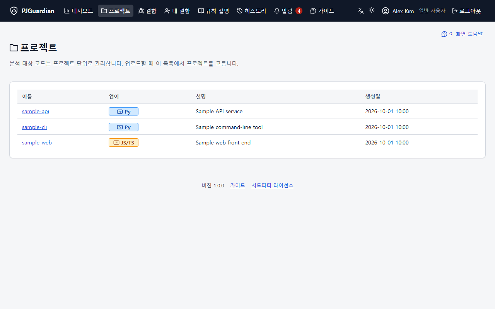
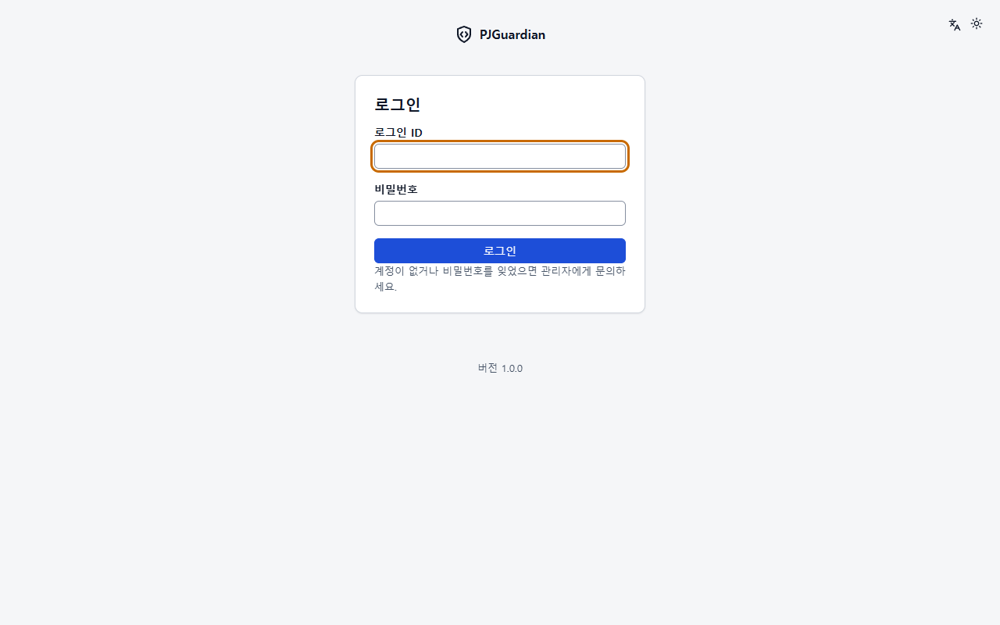

# PJGuardian 주요 기능

[English](features.md)

PJGuardian은 팀이 직접 설치해 쓰는 웹 애플리케이션이다. 코드에 정적 분석 도구 **ruff**(Python)와 **ESLint**(JavaScript/TypeScript)를 돌리고, 그 결과(결함)를 여러 사람이 함께 관리한다. PHP 8.2 이상·SQLite·Apache로 Windows 또는 Linux에서 동작한다(Linux는 아직 확인하지 않음 — `docs/unverified.md`). 이 문서는 1.0.0의 기능을 요약한 것이고, 자세한 내용은 앱 안의 사용자·관리자 가이드와 `CHANGELOG.md`에 있다.

모든 화면 그림은 가짜 데이터 설치본(가상의 사용자 `alex`·`demo-admin`, 가상의 프로젝트, `example.invalid` 주소)에서 `node tools/make_readme_screenshots.mjs`로 만든다. 설치본의 서버 파일 경로는 그림에서 가렸다("(경로 가림)").

## 코드 올리기와 분석

- **zip·폴더 업로드**: zip은 8MB 조각으로 올리고, 끊기면 이어 올린다. 브라우저에서 폴더를 고르면 압축 없이(STORE) 묶어 보내며, `node_modules`·`.git`·`__MACOSX` 같은 기본 제외 대상은 묶기 전에 뺀다.
- **안전한 해제와 사전 검사**: 경로 조작·절대 경로·심볼릭 링크·중첩 zip·Windows에서 쓸 수 없는 이름·대소문자 충돌을 막고, 크기 한도는 실제로 쓴 바이트로 검사한다. 분석 전에 대상 파일 수와 경고(예: 첫 업로드와 다른 최상위 폴더)를 보여 주고 계속할지 묻는다.
- **바꿀 수 있는 한도**: zip 최대 크기(기본 2GB), 압축 해제 후 최대 크기(기본 10GB), 최대 파일 수(기본 1,000,000개)는 관리자 설정 관리 > 분석 탭에 있다.
- **큐와 워커**: 분석은 백그라운드 워커가 순서대로 처리한다(전체 동시 2개, 프로젝트당 1개). 분석 화면에서 상태·결과 요약을 보고, 실패하면 오류 코드와 가이드 링크를 본다.
- **서버가 관리하는 도구**: 체크섬과 스모크 시험을 통과한 `bin/`의 도구 버전만 쓰고, 분석마다 도구 버전과 설정 출처를 남긴다. ESLint는 늘 서버가 만든 설정을 쓰며 업로드된 ESLint 설정 파일은 무시한다. 문법 오류는 분석 실패가 아니라 `syntax-error` 결함으로 기록한다.

## 결함 추적

- **바뀌지 않는 식별**: 결함은 줄 번호만이 아니라 파일 경로·규칙·코드 내용으로 식별하므로 줄이 밀려도 같은 결함이다. 다시 분석해 더 이상 나오지 않으면(파일이 지워진 경우 포함) 자동으로 해결되고, 다시 나오면 재오픈된다. 실패하거나 취소된 분석은 아무것도 바꾸지 않는다.
- **목록과 검색**: 검색 영역에서 조건(검색어·파일·규칙·심각도·상태·담당자·Run)을 정한 뒤 검색한다. 표에는 Run·최근 감지 열이 있고 머리글로 정렬한다.
- **상세와 코드 뷰어**: 결함 위치, 처음·마지막으로 감지한 시점, 그 Run의 코드를 읽기 전용 CodeMirror 6 뷰어로 보여 준다.
- **처리**: 담당자·심각도·상태를 하나씩 또는 일괄로 바꾸고, 사유는 변경 이력에 남는다. 다른 사람이 먼저 바꿨으면 덮어쓰지 않고 알려 준다. "내 결함"은 나에게 지정된 결함 목록이다.
- **규칙별 기본 심각도**: 새 결함에 규칙의 기본 심각도를 자동으로 붙이고, 그 값이 규칙에서 왔는지 사람이 정했는지 화면에 표시한다.

## Run과 히스토리

- **Run**은 프로젝트의 성공한 분석 회차다(Run 1, Run 2, …). 과거 Run 시점의 결함 목록을 읽기 전용으로 본다. 프로젝트마다 최근 15개 Run의 상세를 보관하고, 관리자는 오래된 Run의 상세를 지울 수 있다.
- **히스토리** 화면은 Run마다 신규·재오픈·해결 결함을 차트로 보여 주고, 각 Run을 직전 Run과 비교한다(신규·해결·재오픈·유지, 심각도별 건수, 상위 규칙·파일).

## 대시보드

- 프로젝트 수, 심각도·상태별 열린 결함, 내게 지정된 결함, 최근 분석 요약과 프로젝트별 추이, 규칙·파일 상위 10, 언어·도구별 현황을 보여 준다.
- 차트마다 "표로 보기"가 있고, 막대나 점을 누르면 해당 결함 목록이나 분석으로 이동한다.

## 규칙

- 설치된 ruff·ESLint 버전의 규칙 설명을 검색·필터와 Python 탭·JavaScript/TypeScript 탭으로 보고, 도구 버전 사이에 바뀐 내용을 확인한다.
- 자주 나오는 규칙 124개(ruff 59, ESLint 65)에 쉬운 설명·나쁜 예·고친 코드·고치는 법이 있다. 실제 도구로 확인한 예시만 보인다.
- 관리자는 규칙을 하나씩, 또는 미리보기 후 여러 규칙을 한 번에 켜고 끈다.

## 내보내기와 알림

- 결함 목록·내게 지정된 결함·규칙 목록을 화면과 같은 조건으로 CSV·Excel로 내보낸다. 스프레드시트가 수식으로 읽을 수 있는 셀 값은 무력화한다.
- 분석 완료·실패, 담당자 지정, 내 결함 변경, 새 결함 요약을 앱 안에서 알린다(헤더 배지·알림 패널·종류별 설정).

## 소스 저장소와 주기 분석

- **Git**·**Perforce**에서 코드를 바로 가져와 분석한다. 자격 증명은 암호화해 저장하고, 허용한 호스트에만 접속하며, 관리자가 허용 호스트마다 연결을 시험할 수 있다.
- **주기 분석**: N일 간격으로 정한 시각에 분석한다. 커밋이나 changelist가 그대로면 분석을 건너뛰고 "성공(변경 없음)"으로 기록한다.

## 계정과 접근

- 역할(admin·user), 그룹 관리자가 있는 사용자 그룹, 계정 잠금, 비밀번호 정책(8자 이상·2종).
- 프로젝트는 관리자와 그 프로젝트에 매핑된 사용자·그룹만 본다. 볼 수 없는 프로젝트는 없는 프로젝트와 똑같이(404) 응답한다.
- CSV 파일로 미리보기 후 계정을 한 번에 만들거나 비활성화한다.

## 외부 인증

- **LDAP/AD**, **OpenID Connect**(PKCE를 쓰는 인가 코드 방식), **SAML 2.0**(SP 시작 로그인, 서명 검증은 onelogin/php-saml 라이브러리).
- 외부 인증으로 처음 로그인하면 관리자 승인을 기다리는 계정이 만들어지고, 승인 전에는 아무 권한이 없다.

## 운영

- **백업·복원**: DB·민감 값을 뺀 설정·코드 스냅샷·`bin/` 체크섬을 지금 또는 자동(매일·매주·매월)으로 백업하고, 만든 직후 검증한다. 화면이나 명령줄로 복원하며 새 PC로 옮길 수도 있다. 암호화 키는 따로 내보낸다.
- **시스템 모니터링**: 카드 9개(워커·큐·디스크·백업·도구·HTTPS 인증서·주기 분석·최근 실패·앱), 관리자용 경고 배너, 외부 감시 도구용 `/health`.
- **관리자 장애 이메일**: 워커 정지·디스크 부족 같은 경고·오류를 SMTP(PHPMailer)로 보낸다. 같은 사건은 재발송 간격 안에 다시 보내지 않고, 복구되면 알린다.
- **감사 로그**: 관리 작업과 보안 사건을 사람이 읽는 설명과 함께 남기고, 조건 검색과 CSV 내보내기를 제공한다. 해시 체인과 DB 밖 기록으로 바뀐 것이 없는지 검사한다.
- **업그레이드 유지보수 모드**: 업그레이드를 미리 알리고 유지보수 모드를 켠다(백업이 성공해야 켜짐). 켜진 동안 관리자가 아닌 사용자는 조회만 하고, 워커는 새 분석을 시작하지 않는다.
- **설정 관리**: 허용된 운영 설정을 브라우저에서 바꾼다(변경 미리보기, 값의 출처, 기본값으로 되돌리기).

## 화면 언어·테마와 도움말

- 한국어·영어 화면, 라이트·다크·시스템 테마(계정마다 저장).
- 앱 안의 사용자·관리자 가이드(절 단위 페이지·검색), 오류 코드표, 주요 화면의 도움말 링크, 관리자가 화면에서 편집하는 FAQ.

다크 테마 화면(영어): [대시보드](screenshots/dashboard-dark.png), [결함 상세](screenshots/defect-detail-dark.png).

## 보안

- 상태를 바꾸는 모든 요청에 CSRF 토큰, 앱 자신의 스크립트만 허용하는 콘텐츠 보안 정책(CSP), 앱 한 곳에서 설정하는 HSTS, 모든 라우트의 권한 행렬 자동 시험.
- 외부 명령은 셸 없이 `bin/`에서만 실행하고, 자격 증명은 명령행이 아니라 환경 변수로 넘긴다.
- 최초 관리자의 초기 비밀번호는 `admin`이다. 바꿀 때까지 관리자 화면에 경고 배너가, 시스템 모니터링에 경고가 표시된다 — 설치 직후 바꾸세요.
- 리버스 프록시 뒤에서는 설정에 등록한 프록시를 거친 요청만 전달 헤더의 사용자 주소를 믿는다.

## 성능

개발 PC(Windows, 앱·부하 발생기·워커가 한 대)에서 결함 5만 건 프로젝트로 잰 결과, 동시 사용자 50명까지 화면 응답이 0.5초 안(p95)이었고 오류는 없었다. 개발 PC 숫자이며 보장값이 아니다. 측정 방법과 전체 결과는 `docs/performance.md`, 권장 서버 사양은 `docs/server_sizing.md`에 있다.
