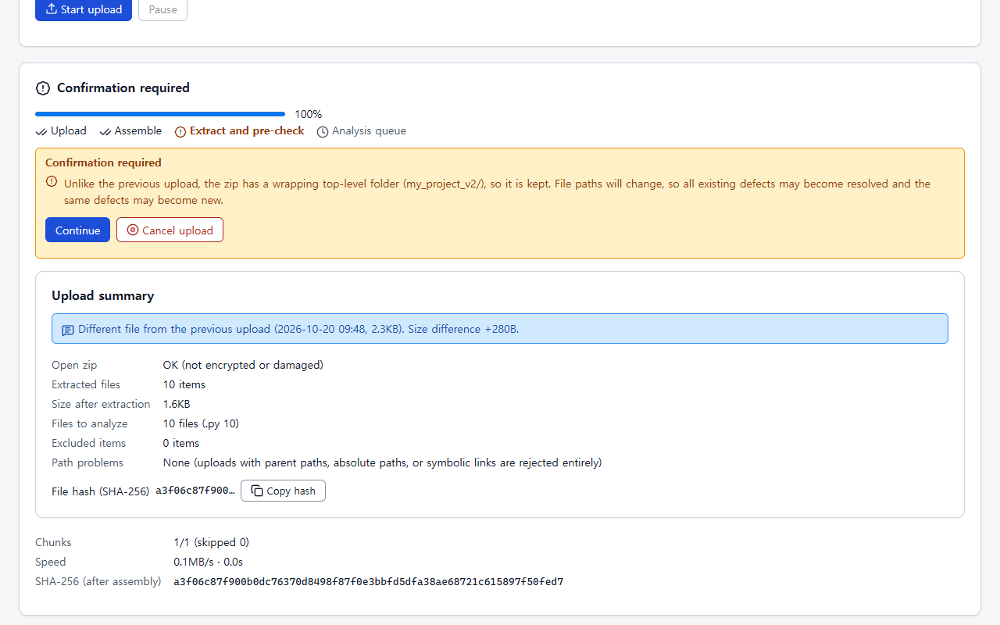
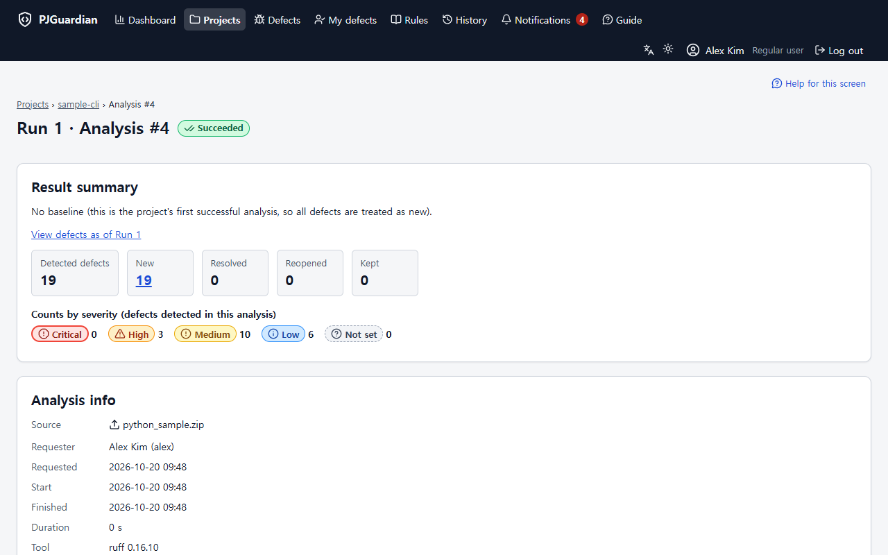
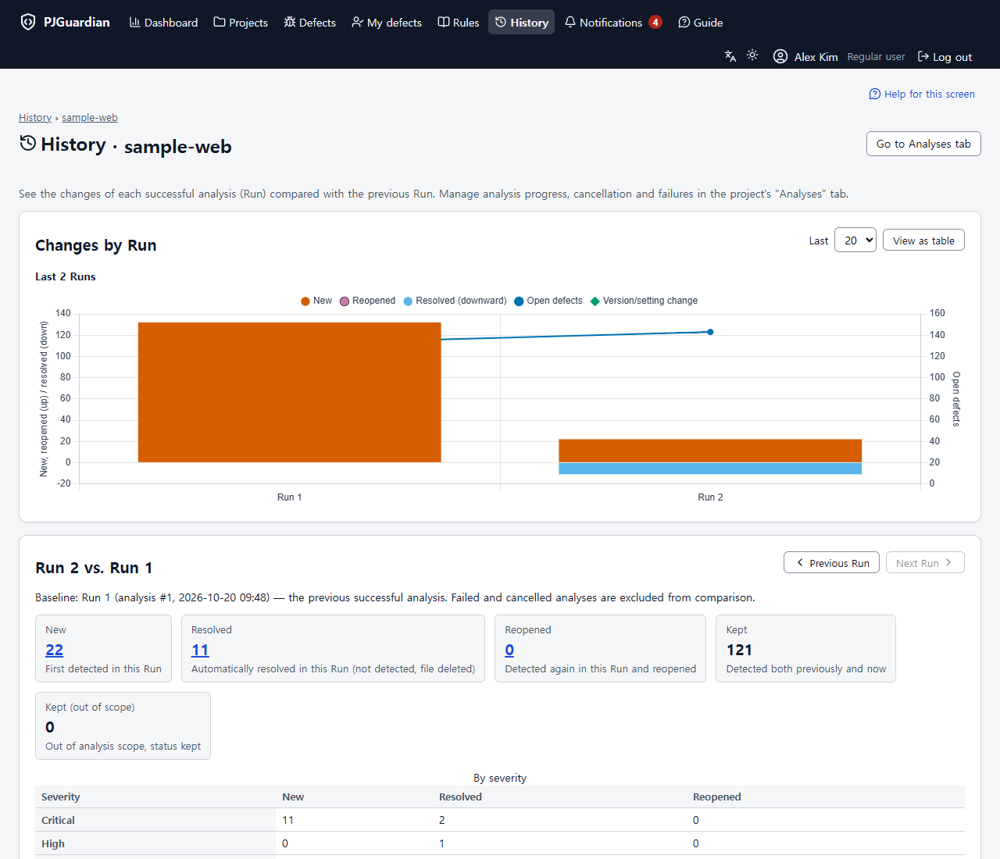
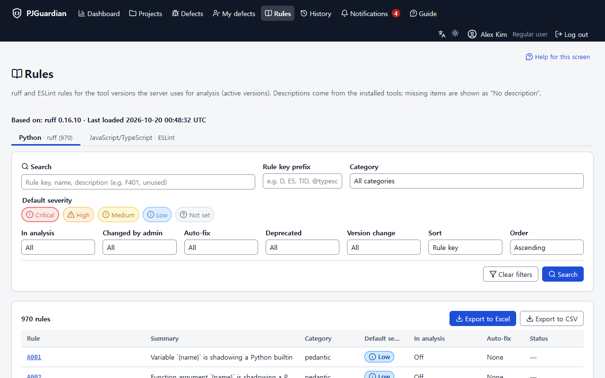
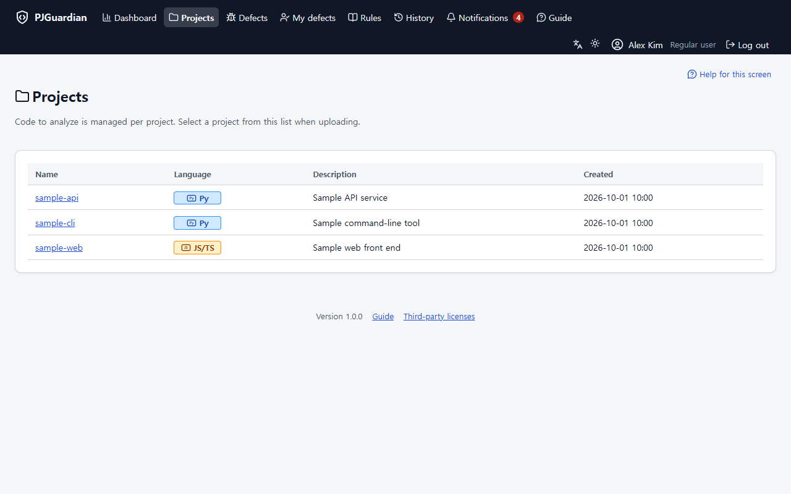
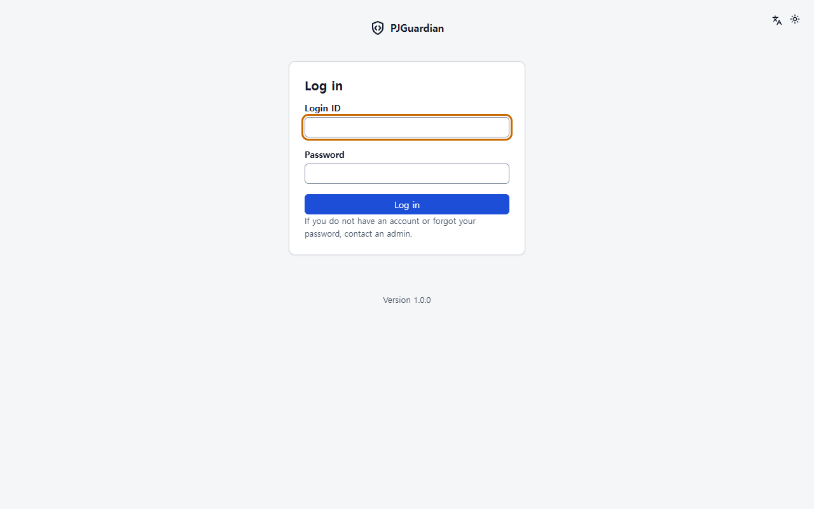
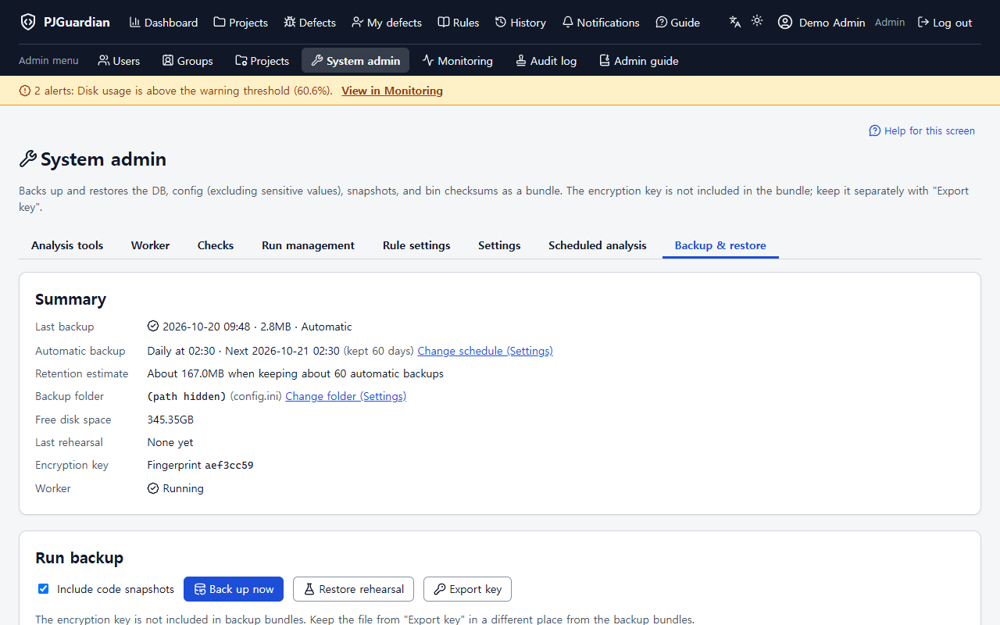
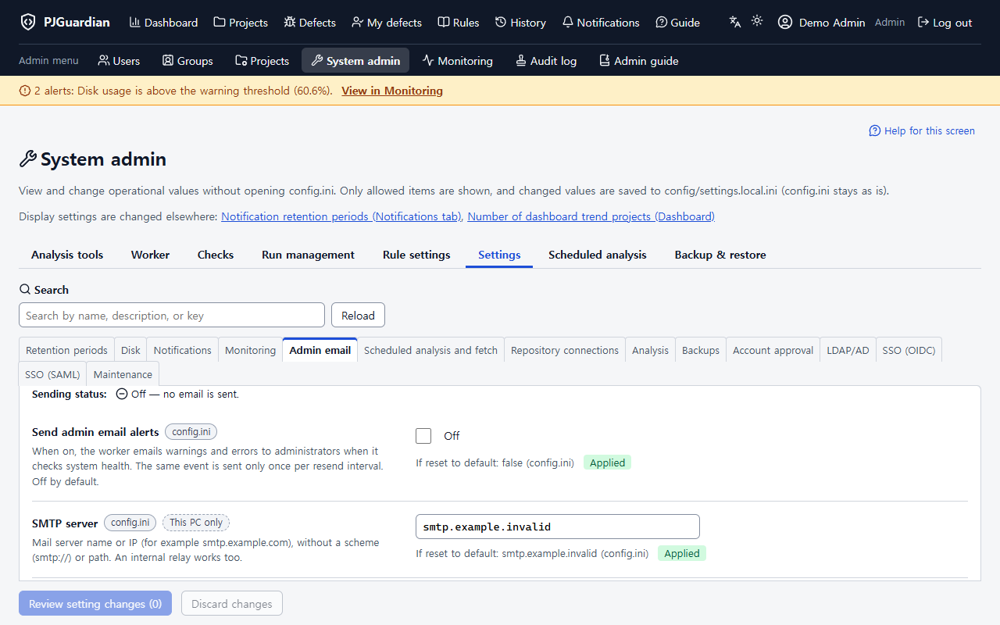
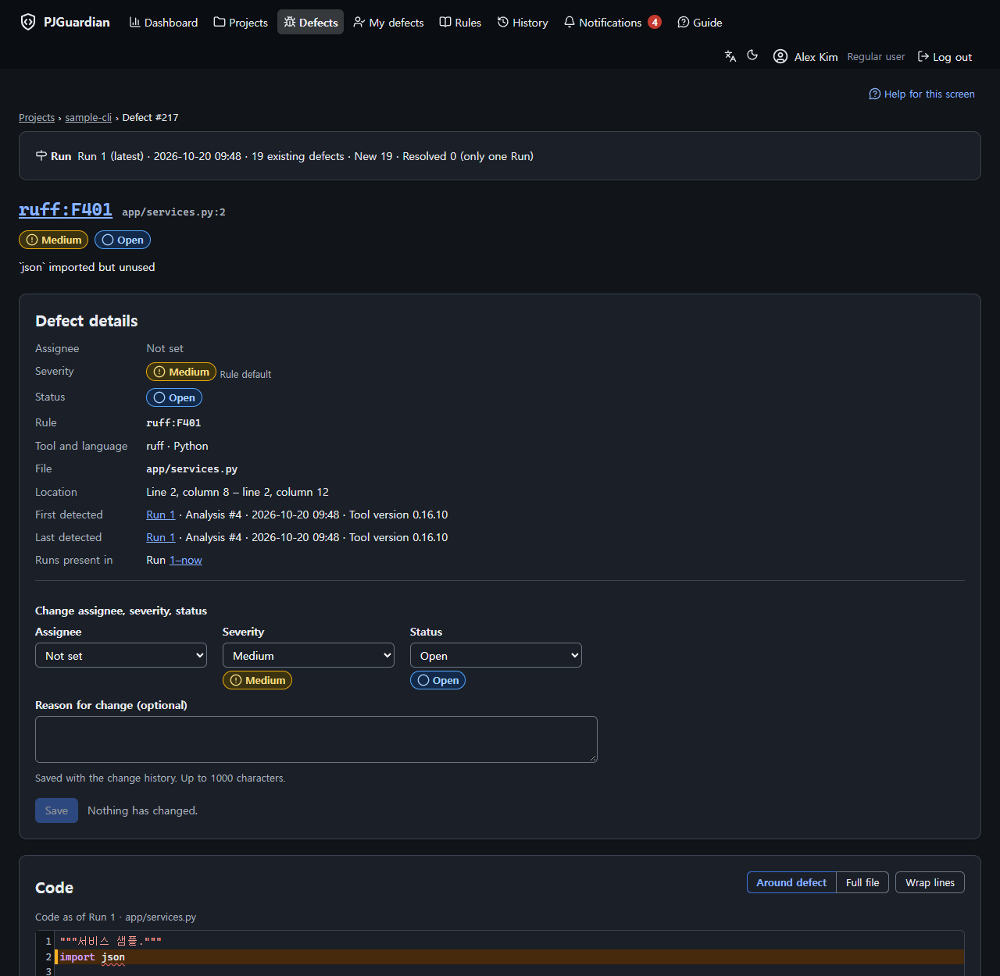
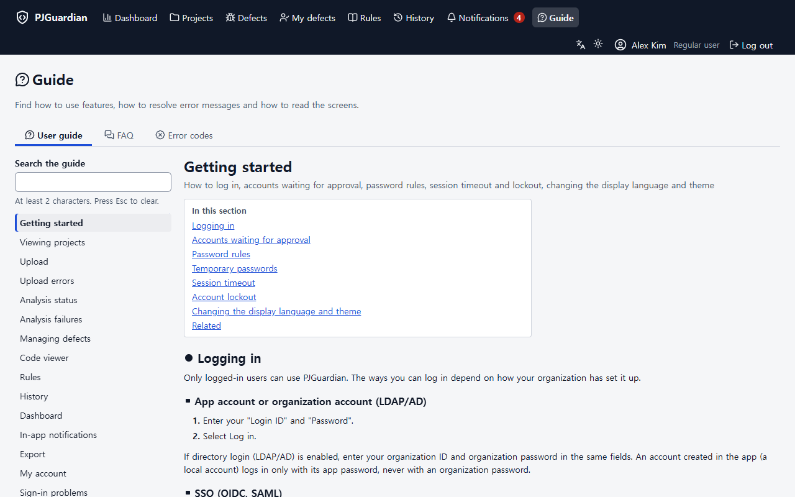

# PJGuardian features

[한국어](features.ko.md)

PJGuardian is a self-hosted web application where a team runs the static analyzers **ruff** (Python) and **ESLint** (JavaScript/TypeScript) on its code and manages the findings ("defects") together. It runs on PHP 8.2+ with SQLite and Apache on Windows or Linux (Linux has not been verified yet — `docs/unverified.md`). This page summarizes what version 1.0.0 does; the details are in the built-in user and admin guides and in `CHANGELOG.md`.

All screenshots come from a fake-data demo install (made-up users such as `alex` and `demo-admin`, made-up projects, `example.invalid` addresses) and are regenerated with `node tools/make_readme_screenshots.mjs`. Server file paths shown by the demo install are hidden in the images ("(path hidden)").

## Uploading code and running analysis

- **Zip or folder upload**: zips are sent in 8 MB chunks and an interrupted upload can be resumed. When you pick a folder in the browser, it is bundled without compression (STORE), and default exclusions such as `node_modules`, `.git` and `__MACOSX` are left out before bundling.
- **Safe extraction and pre-check**: path traversal, absolute paths, symbolic links, nested zips, names Windows cannot use and case collisions are rejected, and size limits are checked against the bytes actually written. Before analysis you see the number of target files and any warnings (for example a wrapping top-level folder that differs from the first upload) and decide whether to continue.
- **Limits you can change**: maximum zip size (default 2 GB), maximum extracted size (default 10 GB) and maximum number of files (default 1,000,000) are on the admin Settings > Analysis tab.
- **Queue and worker**: analyses run in order in a background worker, two at a time overall and one at a time per project. The analysis screen shows the status, the result summary and, for failures, an error code with a link to the guide.
- **Server-managed tools**: only tool versions under `bin/` whose checksums and smoke tests pass are used, and each analysis records the tool version and where its settings came from. ESLint always uses a configuration generated by the server; uploaded ESLint configuration files are ignored. Syntax errors are recorded as `syntax-error` defects instead of failing the analysis.

## Defect tracking

- **Stable identity**: a defect is identified by its file path, rule and the content of the code, not only by its line number, so it stays the same defect when lines move. When a new analysis no longer finds a defect it is resolved automatically (also when its file was deleted), and it is reopened if it comes back. Failed or cancelled analyses change nothing.
- **List and search**: set conditions in the search area (text, file, rule, severity, status, assignee, Run) and then search. The table has Run and last-detected columns and sortable headers.
- **Detail and code viewer**: the detail page shows where the defect is, when it was first and last detected, and the code of that Run in a read-only CodeMirror 6 viewer.
- **Handling defects**: change the assignee, severity and status one at a time or in bulk, with a reason that goes into the change history. If someone else changed the same defect first, you are told instead of overwriting their change. "My defects" lists what is assigned to you.
- **Default severity per rule**: new defects get the rule's default severity automatically; the screen shows whether a severity came from the rule or was set by a person.

## Runs and history

- A **Run** is a successful analysis of a project (Run 1, Run 2, …). You can open the defect list as it was at an earlier Run; past Runs are read-only. Details of the latest 15 Runs per project are kept, and an admin can delete the details of older Runs.
- The **history** page charts new, reopened and resolved defects per Run and compares each Run with the previous one (new, resolved, reopened, kept, counts by severity, top rules and files).

## Dashboard

- Summary of projects, open defects by severity and status, defects assigned to you and recent analyses; trends per project; top 10 rules and files; status by language and tool.
- Every chart has a "View as table" alternative, and clicking a bar or point opens the matching defect list or analysis.

## Rules

- Rule descriptions for the installed ruff and ESLint versions, with search, filters, a Python tab and a JavaScript/TypeScript tab, and the changes between tool versions.
- Plain-language explanations with a bad example, a fixed example and how to fix it for 124 frequently seen rules (59 ruff, 65 ESLint). Only examples confirmed with the real tools are shown.
- Admins can turn rules on or off one at a time, or for many rules at once after a preview.

## Export and notifications

- Export the defect list, your assigned defects and the rule list to CSV or Excel with the same conditions as the screen. Cell values that a spreadsheet could read as formulas are neutralized.
- In-app notifications for finished or failed analyses, assignments, changes to your defects and new-defect summaries, with a header badge, a notification panel and per-type settings.

## Source repositories and scheduled analysis

- Fetch code directly from **Git** or **Perforce** and analyze it. Credentials are stored encrypted, only allowed hosts can be reached, and admins can test the connection to each allowed host.
- **Scheduled analysis** every N days at a set time. If the commit or changelist has not changed, the analysis is skipped and recorded as "Succeeded (no changes)".

## Accounts and access

- Roles (admin, user), user groups with group managers, account lockout and a password policy (at least 8 characters with 2 character types).
- Projects are visible only to admins and to the users and groups mapped to them. A project you cannot see answers exactly like one that does not exist (404).
- Create or deactivate many accounts at once from a CSV file after a preview.

## External sign-in

- **LDAP/AD**, **OpenID Connect** (authorization code flow with PKCE) and **SAML 2.0** (service-provider-initiated sign-in; signatures are checked by the onelogin/php-saml library).
- The first sign-in through an external provider creates an account that waits for admin approval and has no access until approved.

## Operations

- **Backup and restore**: back up now or automatically (daily, weekly or monthly) — the database, configuration without sensitive values, code snapshots and `bin/` checksums — with verification right after each backup. Restore from the screen or from the command line, including onto a new PC. The encryption key is exported separately.
- **System monitoring**: nine cards (worker, queue, disk, backups, tools, HTTPS certificate, scheduled analysis, recent failures, app), an alert banner for admins and a `/health` endpoint for external monitors.
- **Admin email alerts**: warnings and errors such as a stopped worker or low disk space are emailed over SMTP (PHPMailer). The same event is not repeated within the resend interval, and a recovery email is sent.
- **Audit log**: admin actions and security events with a readable description for each entry, filters and CSV export. A hash chain plus a record kept outside the database lets you check that nothing was changed.
- **Upgrade maintenance mode**: announce the upgrade, then turn on maintenance mode (it turns on only after a backup succeeds). While it is on, non-admin users can only read and the worker starts no new analyses.
- **Settings screen**: allowed operational settings can be changed from the browser with a preview of the changes, the source of each value and a way back to the default.

## Language, theme and help

- Korean and English screens, and light, dark or system theme, saved per account.
- Built-in user and admin guides (one section per page, with search), an error-code table, help links on the main screens, and an FAQ that admins edit on the screen.

## Security

- CSRF tokens on every state-changing request, a Content Security Policy that allows only the app's own scripts, HSTS set in one place in the app, and an automated permission matrix test over all routes.
- External commands run without a shell and only from `bin/`; credentials are passed in environment variables, not on the command line.
- The first admin account's initial password is `admin`. Until it is changed, admins see a warning banner and the monitoring page shows a warning — change it right after installation.
- Behind a reverse proxy, forwarded client addresses are trusted only from proxies listed in the settings.

## Performance

Measured on the development PC (Windows, app, load generator and worker on one machine) with a project of 50,000 defects: screen responses stayed within 0.5 seconds (p95) up to 50 concurrent users, with no errors. These are development-PC numbers, not a guarantee; see `docs/performance.md` for the method and full results, and `docs/server_sizing.md` for recommended server sizes.
